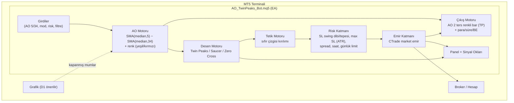
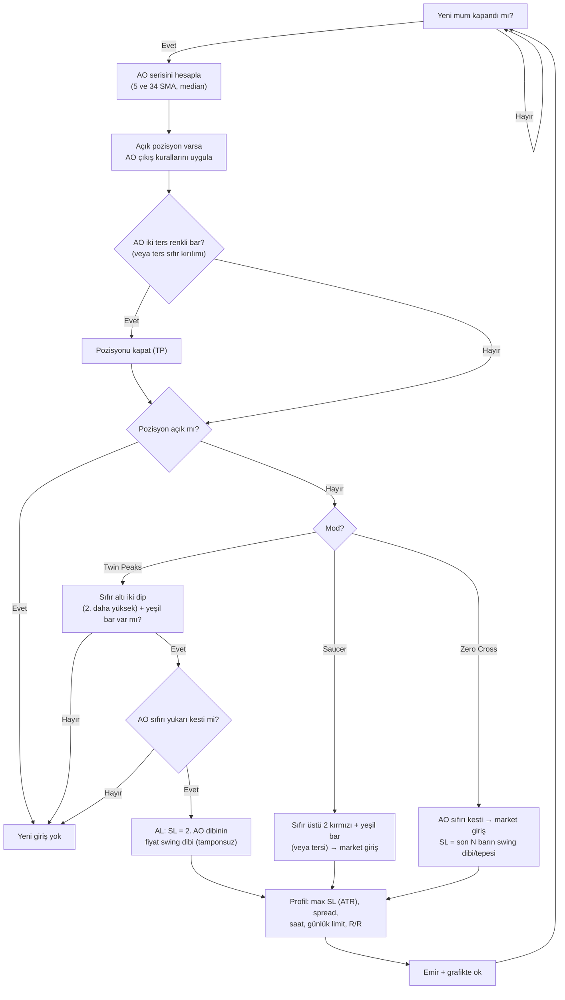
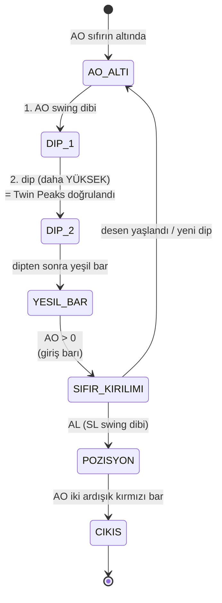

# Bill Williams Awesome Oscillator (Twin Peaks) — MT5 Tam Otomatik Bot Tasarımı

> **Kaynak:** [Trading Strategy Guides — Bill Williams Awesome Oscillator Strategy](https://tradingstrategyguides.com/bill-williams-awesome-oscillator-strategy/)
> **Bot dosyası:** `AO_TwinPeaks_Bot.mq5` (MT5 / MQL5, tam otomatik EA)
> **Bu belge:** Kaynağın detaylı analizi + çıkarılan tasarım şeması + botun kurulum ve kullanım kılavuzu

---

## 1. Kaynak Analizi — Makalede Ne Anlatılıyor?

### 1.1 Awesome Oscillator (AO) nedir?

- Bill Williams'ın **momentum** osilatörü; MACD'ye benzer bir **histogram**, ancak kapanış yerine **medyan fiyat** kullanır ve sinyal çizgisi yoktur.
- Kısa dönemli momentumu uzun dönemli momentumla karşılaştırır.
- Makale: *"AO, son derece az yanlış sinyal verdiği için 'süper gösterge' olarak da anılır."* Karşılaştırma örneğinde 4 sıfır-kırılımından yalnızca 1'i yanlış çıkmış.
- Trend piyasalarında **trende tutunmaya** yardım eder; diğer momentum osilatörleri küçük geri çekilmelerde stop ettirirken AO trendde kalır.
- Kullanım alanları (makale): ① trendlerden yararlanma, ② momentum ölçme, ③ olası dönüşleri öngörme.
- Makalenin tercih ettiği zaman dilimi: **günlük (D1)** — "kapsamlı araştırma ve geriye dönük testler sonucunda D1 en iyi performansı veriyor". Ancak strateji tüm piyasalarda (hisse, emtia, endeks, forex) ve farklı TF'lerde uygulanabilir.

### 1.2 Formül ve ayarlar

```
MEDIAN PRICE = (HIGH + LOW) / 2
AO           = SMA(MEDIAN PRICE, 5) − SMA(MEDIAN PRICE, 34)
```

- Varsayılan ayar **5 vs 34**'tür.
- **Sıfır çizgisi:** AO > 0 → boğa momentumu; AO < 0 → ayı momentumu. Sıfırı yukarı kesmesi boğa momentumu ve olası trend dönüşü; aşağı kesmesi ayı momentumu.
- **Renk mantığı:** histogram barı bir önceki bardan **yüksekse yeşil**, **düşükse kırmızı**. Renk değişimi momentumun hızındaki değişimi gösterir; sıfır çizgisinin kesilmesi ise gerçek duygu değişimidir.
- Kısa vadeli momentum uzun vadeliden önce döner → trend değişimi önce kısa vadede görünür, sonra yayılır.

### 1.3 AO'nun dört sinyal ailesi

| Sinyal | Koşullar | Yorum |
|---|---|---|
| **Zero-line crossover** | AO sıfırı yukarı/aşağı keser | En basit kullanım; momentum değişimi / olası dönüş |
| **Saucer (tabak)** | Sıfırın aynı tarafında 3 bar: 2 aynı renkli bar + dönüş barı | Saf momentum **devam** sinyali; kaçırılan trende ikinci şans |
| **Twin Peaks** | Sıfırın aynı tarafında iki dip/tepe; ikinci dip daha yüksek (veya ikinci tepe daha düşük) | Makalenin **ana stratejisi**; en iyi risk/ödül |
| **Divergence** | Fiyat yeni dip/tepe yaparken AO yapmaz | Dönüş uyarısı (makalede kısaca anılır) |

**Saucer kuralları (makale):**
- *Boğa:* ① AO sıfırın **üstünde**, ② **2 ardışık kırmızı** bar, ③ ikinci kırmızı bar birinciden **düşük**, ④ üçüncü bar **yeşil ve ikinciden yüksek**.
- *Ayı:* ① AO sıfırın **altında**, ② **2 ardışık yeşil** bar, ③ ikinci yeşil bar birinciden düşük, ④ üçüncü bar **kırmızı ve ikinciden düşük**.

### 1.4 Makalenin ana stratejisi: Twin Peaks — ALIM için 6 adım

| # | Adım | Açıklama |
|---|---|---|
| 1 | **AO sıfırın altında mı?** | Desen sıfır çizgisinin altında oluşur (ayı momentumu bölgesi) |
| 2 | **İki ardışık AO dip** | Histogramda iki swing dip; **ikinci dip birinciden YÜKSEK** (twin peaks) |
| 3 | **İkinci dipten sonra yeşil bar** | Histogram hemen yeşile dönmeli → desen doğrulanır ("alıcılar devreye girdi") |
| 4 | **AO sıfır çizgisini yukarı kesince AL** | Gerçek duygu değişimi sıfır kırılımıdır → piyasa fiyatından alım |
| 5 | **SL = son swing dibinin altı** | 2. AO dibiyle hizalanan fiyat swing dibi; **tampon YOK** ("dibin hafif kırılması deseni geçersiz kılar") |
| 6 | **TP = AO iki ardışık KIRMIZI bar bastığında kapat** | Zayıflığın ilk işaretinde kâr al; piyasa ters dönebilir |

> **SATIM:** Aynı kuralların tersi — AO sıfırın **üstünde**, iki **tepe** (ikincisi **daha düşük**), tepeden sonra **kırmızı bar**, AO sıfırı **aşağı** kesince SAT; **SL tepe swing high'ın üstünde; TP iki ardışık YEŞİL barda**.

### 1.5 Makalenin felsefesi / uyarıları

- Amaç **tepe/dip yakalamak değil**, momentum lehe döndüğünde **trende binmek**.
- Breakout işlemlerinin daha sofistike bir hali: her ikisi de momentum kaymasını bekler.
- "Büyük kazançlar, küçük kayıplar": SL swing dibinin hemen dışında olduğu için risk küçük, TP momentum bitene kadar taşındığı için ödül büyük.
- Makale, stratejinin **risk/ödül** üstünlüğünü vurgular ve Twin Peaks'i "en popüler AO stratejisi" olarak tanımlar.

---

## 2. Tasarım Şeması

### 2.1 Sistem mimarisi



### 2.2 Ana akış



### 2.3 Olay akışı (örnek: LONG)



### 2.4 Örnek senaryo (LONG)

```
AO değeri
  0 ────────────────────────────●━━━━━━━━━━━━━  ← sıfır kırılımı → AL
       ╲                      ╱   ↑
        ╲   ╱╲    ╱╲        ╱     giriş (bar kapanışından sonraki tick)
         ╲ ╱  ╲  ╱  ╲      ╱
          ●    ●     ╲    ╱        ● = AO swing dipleri
        1.dip  2.dip   ╲  ╱          2. dip > 1. dip  (Twin Peaks)
        (düşük) (yüksek) ╲╱
                            yeşil bar (Adım 3)

Fiyat:  SL = 2. AO dibine denk gelen fiyat swing dibi (tamponsuz)
        Çıkış = AO iki ardışık kırmızı bar
```

---

## 3. Botun Kuralları (otomatikleştirilmiş hali)

### 3.1 Twin Peaks modu (varsayılan — makalenin 6 adımı)

| Adım | Kural | Botun uygulaması |
|---|---|---|
| 1 | AO sıfırın altında | Her iki AO pivotu da `AO < 0` |
| 2 | İki ardışık dip, 2. daha yüksek | `InpAOPivotStrength` kadar bar sağında/solunda ekstrem olan en yeni iki AO dibi; `AO[2.dip] > AO[1.dip]` |
| 3 | İkinci dipten sonra yeşil bar | `AO[2.dip − 1] > AO[2.dip]` (pivot tanımı gereği) |
| 4 | Sıfır çizgisini yukarı kesince AL | `AO[1] > 0` ve `AO[2] ≤ 0` → bar kapanışından sonraki ilk tick'te market emir |
| 5 | SL = son swing dibi | 2. AO dibinin barı çevresindeki (`InpSLSwingBars`) en düşük fiyat; **tampon varsayılan 0** |
| 6 | TP = iki ardışık kırmızı bar | `AO[1] < AO[2] < AO[3]` olunca pozisyonu kapat |

SATIM: AO > 0 bölgesinde iki tepe (2. daha düşük), tepeden sonra kırmızı bar, `AO[1] < 0 && AO[2] ≥ 0` → SAT; SL = 2. tepenin fiyat swing high'ı; çıkış `AO[1] > AO[2] > AO[3]`.

### 3.2 Saucer modu

| Yön | Koşullar (bar 1 = son kapanmış) | Giriş |
|---|---|---|
| LONG | `AO[1..3] > 0`, `AO[2] < AO[3] < AO[4]` (2 kırmızı), `AO[1] > AO[2]` (yeşil ve daha yüksek) | Bar 1 kapanışından sonraki tick |
| SHORT | `AO[1..3] < 0`, `AO[2] > AO[3] > AO[4]` (2 yeşil), `AO[1] < AO[2]` (kırmızı ve daha düşük) | Aynı |

SL: son `InpSLSwingLookbackBars` barın swing dibi/tepesi (`InpSLBufferPoints` tamponla).

### 3.3 Zero Cross modu

- `AO[1] > 0 && AO[2] ≤ 0` → LONG; `AO[1] < 0 && AO[2] ≥ 0` → SHORT.
- SL: son `InpSLSwingLookbackBars` barın swing dibi/tepesi.
- Çıkış: AO çıkış kuralları (varsayılan iki ters renkli bar) ve/veya ters sıfır kırılımı (`InpExitOnOppositeZeroCross`).

### 3.4 Çıkışlar (tüm modlar)

| Çıkış | Kural | Parametre |
|---|---|---|
| AO momentum çıkışı | LONG'da 2 ardışık kırmızı bar / SHORT'ta 2 ardışık yeşil bar | `InpUseIndicatorExit` (vars. açık) |
| Ters sıfır kırılımı | AO ters yönde sıfırı keserse kapat | `InpExitOnOppositeZeroCross` (vars. kapalı) |
| Sabit TP | `InpUseFixedTP` ise broker TP = risk × `InpFixedTP_RR` | vars. kapalı (makale göstergesel çıkış kullanır) |
| Broker SL | Swing dibi/tepesi (tamponlu/tamponsuz) | `InpSLBufferPoints` |
| Para TP/SL | Hesap birimi bazlı | `InpMoneyTakeProfit` / `InpMoneyStopLoss` |
| Süre limiti | Pozisyon yaşı | `InpMaxPositionMinutes` |
| BE | Kâr = R × N olunca SL girişe | `InpMoveToBEAtRR` |

### 3.5 Makalede öznel kalan noktaların otomatikleştirilmesi

| Makaledeki ifade | Botun otomatik tanımı |
|---|---|
| "SMA(median,5) − SMA(median,34)" | `iMA(PRICE_MEDIAN, SMA)` iki handle'ın farkı (periyotlar değiştirilebilir) |
| "Yeşil / kırmızı bar" | `AO[i] > AO[i+1]` → yeşil, `AO[i] < AO[i+1]` → kırmızı (MT5 renk mantığı) |
| "İki ardışık swing dip" | `InpAOPivotStrength` (vars. 2) bar sağında/solunda ekstrem olan AO dipleri |
| "İkinci dip daha yüksek" | `AO[2.dip] > AO[1.dip]` |
| "Dipten sonra hemen yeşil bar" | `AO[2.dip − 1] > AO[2.dip]` |
| "Sıfır çizgisini kırınca gir" | `AO[1] > 0 && AO[2] ≤ 0` (kapanmış bar) → sonraki tick'te market |
| "SL son swing dibine, tamponsuz" | 2. AO dibi çevresindeki en düşük fiyat; `InpSLBufferPoints=0` |
| "İki kırmızı barda TP" | `AO[1] < AO[2] < AO[3]` |
| "Desen yaşı" | `InpMaxPatternAgeBars` (vars. 30) — eski desenlerle işlem yapılmaz |

---

## 4. Parametreler

### 4.1 AO ve desen

| Parametre | Varsayılan | Açıklama |
|---|---|---|
| `InpTimeframe` | `PERIOD_CURRENT` | İşlem TF'i (makale: **D1** önerir) |
| `InpMode` | `AO_TWIN_PEAKS` | `0` Twin Peaks · `1` Saucer · `2` Zero Cross |
| `InpAOFastPeriod` / `InpAOSlowPeriod` | `5` / `34` | AO SMA periyotları (makale varsayılanı) |
| `InpAOPivotStrength` | `2` | AO swing dip/tepe için her iki yanda bar |
| `InpPatternLookbackBars` | `60` | Twin Peaks tarama penceresi |
| `InpMaxPatternAgeBars` | `30` | 2. dip en fazla kaç bar önce (0 = sınırsız) |
| `InpRequireZeroCross` | `true` | Giriş için sıfır kırılımı şartı (Adım 4) |

### 4.2 Çıkış

| Parametre | Varsayılan | Açıklama |
|---|---|---|
| `InpUseIndicatorExit` | `true` | AO iki ters renkli barda kapat |
| `InpExitOnOppositeZeroCross` | `false` | Ters sıfır kırılımında da kapat |
| `InpUseFixedTP` / `InpFixedTP_RR` | `false` / `2.0` | Sabit TP (R çarpanı) |
| `InpSLSwingBars` | `2` | Twin Peaks SL swing penceresi |
| `InpSLBufferPoints` | `0` | SL tamponu (makale: tamponsuz) |
| `InpSLSwingLookbackBars` | `10` | Saucer/Zero Cross SL penceresi |

### 4.3 Pozisyon ve risk

| Parametre | Varsayılan | Açıklama |
|---|---|---|
| `InpLotSize` | `0.01` | Sabit lot |
| `InpUseRiskPercent` / `InpRiskPercent` | `false` / `1.0` | Risk % ile lot |
| `InpMagicNumber` | `20261119` | Magic (diğer botlardan farklı) |
| `InpDeviationPoints` | `20` | Maks. sapma |
| `InpMaxSpreadPoints` | `0` | Maks. spread (0 = kapalı) |
| `InpMaxOpenPositions` | `1` | Maks. açık pozisyon |
| `InpAllowLongs` / `InpAllowShorts` | `true` / `true` | Yön izinleri |
| `InpMaxSL_ATR` | `3.0` | Bu ATR katını aşan SL'de işlem atlanır |
| `InpMoneyTakeProfit` / `InpMoneyStopLoss` | `0` / `0` | Para bazlı çıkışlar |
| `InpMaxPositionMinutes` | `0` | Maks. pozisyon süresi |
| `InpMoveToBEAtRR` | `0.0` | Kâr R×N olunca SL → BE |

### 4.4 Filtreler ve görsel

| Parametre | Varsayılan | Açıklama |
|---|---|---|
| `InpUseTradingHours` / `InpStartHour` / `InpEndHour` | `false` / `0` / `24` | İşlem saatleri |
| `InpMaxTradesPerDay` | `0` | Günlük maks. işlem |
| `InpMaxDailyLoss` | `0` | Günlük maks. zarar |
| `InpDrawArrows` / `InpShowPanel` / `InpDeleteOnExit` / `InpLogSignals` | `true` / `true` / `true` / `false` | Görsel ve log |

---

## 5. Kurulum ve Kullanım

### 5.1 Kurulum (MT5)

1. MT5 → **Dosya → Veri Klasörünü Aç**
2. `MQL5/Experts/` içine `AO_TwinPeaks_Bot.mq5` kopyala
3. **Ctrl+N** → Expert Advisors → botu grafiğe sürükle
4. **Önerilen: D1** (makalenin tercihi), EURUSD / GBPUSD / XAUUSD / endeksler
5. **Algo Trading** açık olmalı
6. Panelde AO değeri, rengi, desen durumu ve son işlem görünür

### 5.2 Strategy Tester

1. **Ctrl+R** → EA: `AO_TwinPeaks_Bot`
2. En az 2–5 yıl (D1 için), model: **"Every tick based on real ticks"** veya D1'de "1 minute OHLC"
3. Optimizasyon: `InpMode` (0/1/2), `InpAOPivotStrength`, `InpMaxPatternAgeBars`, `InpSLSwingBars`, `InpAOFastPeriod`/`InpAOSlowPeriod`
4. Çıkış kuralı (`InpUseIndicatorExit`) açık/kapalı karşılaştırması yapın — makalenin TP'si budur

### 5.3 Hazır preset'ler

| Dosya | Ayar |
|---|---|
| `AO_D1_TwinPeaks.set` | **D1**, Twin Peaks (makalenin önerdiği TF), max SL 4×ATR |
| `AO_H4_TwinPeaks.set` | H4, Twin Peaks (D1'in hızlı versiyonu) |
| `AO_M15_Saucer.set` | M15, **Saucer** modu + sabit TP 1.5 R |

Yükleme: EA parametreleri → **Load** → `.set` dosyası.

---

## 6. Risk ve Sınırlamalar

- **Yatırım tavsiyesi değildir.** Kaldıraçlı işlemlerde ciddi kayıp riski vardır; **önce demo**.
- AO bir **momentum** göstergesidir; yatay/volatil piyasada twin peaks sık oluşur ve yanlış sinyal oranı artar. Makalenin "az yanlış sinyal" iddiası trend piyasaları için geçerlidir.
- Zaman dilimi kritiktir: makale **D1** önerir; düşük TF'lerde gürültü artar, `InpMaxPatternAgeBars` ve `InpAOPivotStrength` mutlaka test edilmelidir.
- AO renk tanımı (bar önceki bardan yüksek/düşük) platforma göre değişebilir; bot MT5 histogram mantığını kullanır.
- Fractal/twin peaks pivotları **sonradan** kesinleşir (`InpAOPivotStrength` bar gecikme). Bot yalnız kapanmış mumlarla çalıştığı için bu gecikmeyi sinyal üretiminde doğal olarak yaşar; geçmişe dönük işlem açmaz.
- SL tamponsuz (`InpSLBufferPoints=0`) olduğu için spread/komisyon stop'u erken tetikleyebilir; broker koşullarına göre 10–20 point tampon önerilir.
- EA yeniden başlatılırsa desen taraması sıfırdan yapılır; açık pozisyonların broker SL/TP'si korunur.
- Geçmiş performans gelecekteki sonuçları garanti etmez.

---

## 7. Dosya Listesi

| Dosya | Açıklama |
|---|---|
| `AO_TwinPeaks_Bot.mq5` | Tam otomatik MT5 robotu (v1.00) |
| `README_AO_Bot.md` | Bu belge: analiz + tasarım + kılavuz |
| `AO_D1_TwinPeaks.set` | D1 Twin Peaks preset'i |
| `AO_H4_TwinPeaks.set` | H4 Twin Peaks preset'i |
| `AO_M15_Saucer.set` | M15 Saucer preset'i |

---

## 8. Kaynakça

- Trading Strategy Guides, *Bill Williams Awesome Oscillator Strategy — Big Profits, Small Losses* —
  <https://tradingstrategyguides.com/bill-williams-awesome-oscillator-strategy/>
- Makalede referans verilen TSG içerikleri: Breakout Triangle Strategy, MACD Trend Following Strategy, Double Top Chart Pattern, Best Momentum Trading Strategies.
