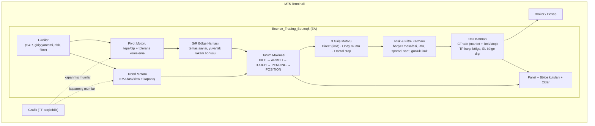
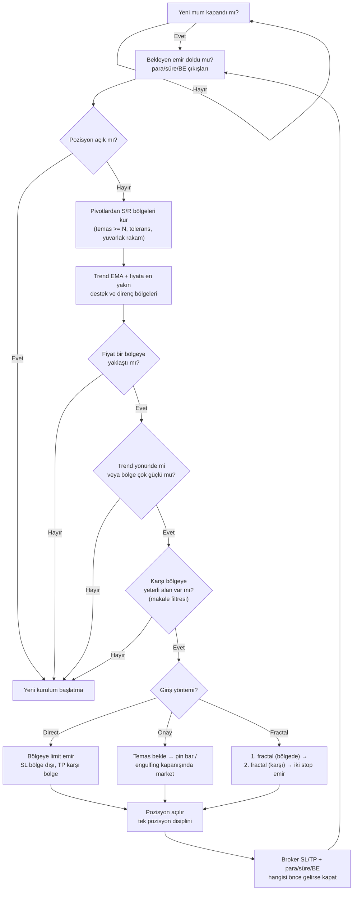
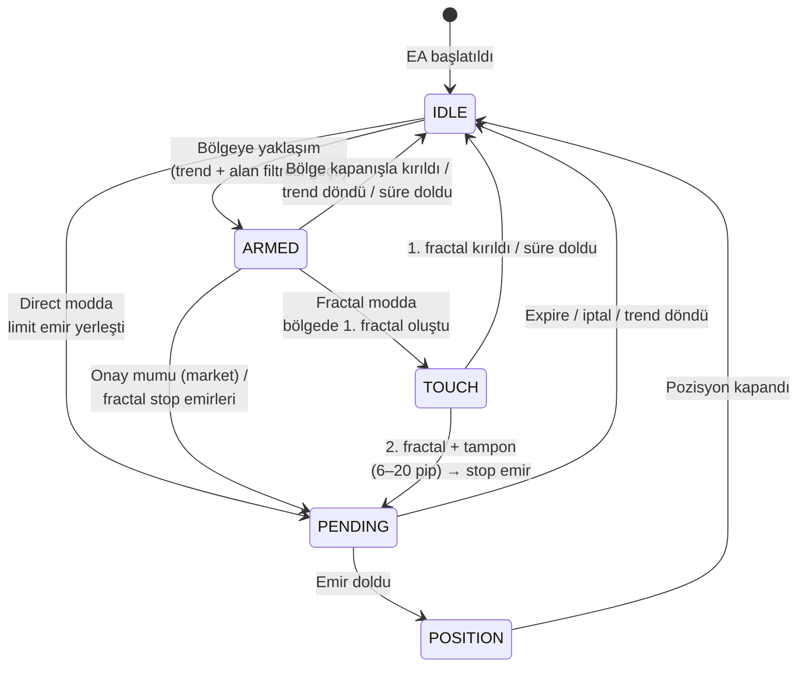

# Support & Resistance Bounce — MT5 Tam Otomatik Bot Tasarımı

> **Kaynak:** [Trading Strategy Guides — Bounce Trading Strategy in Forex](https://tradingstrategyguides.com/bounce-trading-strategy-in-forex/)
> **Bot dosyası:** `Bounce_Trading_Bot.mq5` (MT5 / MQL5, tam otomatik EA)
> **Bu belge:** Kaynağın detaylı analizi + çıkarılan tasarım şeması + botun kurulum ve kullanım kılavuzu

---

## 1. Kaynak Analizi — Makalede Ne Anlatılıyor?

### 1.1 Temel kavram: Destek & Direnç (S&R)

- Destek/direnç, fiyatın **önceden belirlenmiş bariyer bölgeleridir**; fiyat ya bu bölgeyi **kırar (break)** ya da bölgeden **seker (bounce)**.
- Makalenin vurgusu: S&R seviyesinin *nasıl* bulunduğu değil, o seviyeye **nasıl yaklaşıldığı** ve **nasıl işlem yapıldığıdır**.
- S&R belirlemede kullanılan araçlar (makalenin listesi):
  1. Tepeler ve dipler (tops & bottoms)
  2. Trend çizgileri
  3. Trend kanalları
  4. Fibonacci düzeltmeleri
  5. Fibonacci hedefleri / uzantıları
  6. Grafik formasyonları
  7. (Metinde ayrıca) psikolojik eşikler / yuvarlak rakamlar
- S&R üç şekilde kullanılır:
  1. **Hedef (target)** → take-profit'i seviyeye koy.
  2. **Filtre (filter)** → seviyeye doğrudan giden kurulumu hiç alma.
  3. **Tetik / giriş (trigger)** → kırılım veya sekmede pozisyon aç.

### 1.2 "Break or Bounce Spot" — kumdaki çizgi

- Seviye işaretlendiğinde trader'ın **"line in the sand"** (kumdaki çizgi) noktası olur: kararın verileceği tek an.
- Bu önceden işaretleme aynı zamanda **zihinsel filtredir**: diğer tüm fiyat hareketleri yok sayılır, her veri aynı önemde değerlendirilmez → panik/açgözlülük (fear & greed) azalır.
- **Break (kırılım):** Fiyat seviyeyi aşar → yeterli momentum var → breakout işlemi.
- **Bounce (sekme):** Fiyat seviyeyi geçemez → momentum yok → seviyeye "saygı" gösterir → dönüş/düzeltme işlemi.
- Terimler: **Strike = kırılım işlemi**, **Boomerang = kırılımdan sonraki ilk geri çekilme (pullback)**.
- Sekme; küçük bir düzeltme, büyük bir düzeltme veya tam bir dönüş olabilir. **Büyük tepeler/dipler ve Fibonacci seviyeleri genelde en az bir kez "saygı" görür** (fiyat durmadan geçmez).

### 1.3 Üç giriş yöntemi (makalenin kalbi)

| Yöntem | Ne yapılır | Avantaj | Risk / Problem |
|---|---|---|---|
| **Direct** (doğrudan) | Beklenen S&R seviyesine **doğrudan emir** (limit) | **En erken giriş** | Fiyat seviyede durmadan devam edebilir; SL yerleştirmek zor (küçük TF'lerde fitiller seviyeyi aşabilir) |
| **Confirmation of Bounce** (onay) | Fiyatın seviyede **durduğunu teyit eden mum kalıbı** (pin bar, engulfing vb.) beklenir | Fiyat gerçekten duruyor; **net SL seviyesi** var | Fiyat onaydan önce seviyeden uzaklaşabilir; özellikle trende karşı işlemde **geç giriş** |
| **Fractal breakout** (fractal kırılımı) | Seviyede ve karşı tarafta fractal oluşur; **karşı fractal'ın 6–20 pip ötesinde** giriş | İki net seviye ("2 çizgi"), nesnel tetik | Kırılımın yönünü beklemek gerekir; yatay piyasada yanlış sinyal |

### 1.4 Fractal yönteminin adımları (makale)

1. Bir S&R seviyesinin önemli olacağını **öngör**.
2. Fiyat seviyede (veya çok yakınında) durup **bir fractal** oluştursun.
3. Fiyat seviyeden **uzaklaşsın**.
4. Karşı tarafta **ikinci bir fractal** oluşsun.
5. Karşı fractal'ın **kırılımında** gir (6–20 pip ötesi).

> Örnek (makaleden): 4 saatlik grafikte yükseliş trendi → fiyat Fibonacci S&R'ye gelir → 40 pip aşağı gidip (dip bölgesinde) **üstte fractal** oluşturur → fiyat trendle yukarı seker ama direnç fractal'ını kıramaz. Artık **iki fractal = iki çizgi** var. **Üstteki kırılırsa breakout, alttaki kırılırsa "bounce breakout"** (sektikten sonra ters yöne kırılım). Yani **iki seviyeden biri kazanır** — sekmeyi bir kırılım işlemine dönüştürür.

### 1.5 Makalenin şartları / uyarıları

- Başarı olasılığı en yüksek olduğunda iki senaryo:
  1. **Çok güçlü S&R** + güçlü bir **dönüş** yakalama denemesi,
  2. **Trend + trend devamı** için S&R belirleme (sekme = pullback girişi).
- Makale bunun bir "sistem" değil **kavram** olduğunu açıkça söyler: istatistik vermez, **discretionary** (yorum gerektiren) bir yöntemdir ve **çoklu zaman dilimi analizi** + diğer araçlarla birlikte kullanılmalıdır.
- Kural tablosu (makalenin özeti): seviyeleri **önceden** işaretle · doğrudan giriş · onay mumu girişi · fractal kırılımı (6–20 pip) · TP = karşı taraftaki seviye · S&R'yi filtre olarak kullan.

---

## 2. Tasarım Şeması

### 2.1 Sistem mimarisi



### 2.2 Ana akış



### 2.3 Durum makinesi



### 2.4 Örnek senaryo — destek üzerinde LONG (trend devamı)

```
Fiyat
        ╱╲            ╱╲  ← 2. fractal (direnç çizgisi)
 Direnç ┤ ╲    ╱╲    ╱  ╲      kırılırsa → LONG (bounce devamı)
 (hedef)│  ╲  ╱  ╲  ╱    ╲
        │   ╲╱    ╲╱      ╲
 Destek ┤━━━━━━━━━━╲━━━━━━━━━━━━━━━━  ← S/R bölgesi (temas ≥ 3)
 (S/R)  │  ↑ temas   ╲ 1. fractal (destek çizgisi)
        │              ╲ kırılırsa → SHORT (bounce fail = breakout)
        └─────────────────────────────────► zaman
SL: destek altı − tampon | TP: karşı direnç bölgesi
Giriş: 2. fractal + 6–20 pip (fractal modu)
       veya bölgede pin bar kapanışı (onay modu)
```

---

## 3. Botun Kuralları (otomatikleştirilmiş hali)

### 3.1 S/R bölge motoru

| Adım | Kural |
|---|---|
| Pivot | `InpPivotStrength` kadar mum sağında/solunda **en yüksek tepe** veya **en düşük dip** |
| Kümeleme | Birbirine `InpZoneToleranceATR × ATR` mesafeden yakın pivotlar **tek bölge** sayılır |
| Bölge | Merkez = pivotların ortalaması, üst/alt kenar = min/max ± toleransın ¼'ü |
| Geçerlilik | **Temas sayısı ≥ `InpMinTouches`** (vars. 2) |
| Güç | Temas sayısı; yuvarlak rakama (`InpRoundStepPips`) yakın bölge **+1 temas** |
| Destek / direnç | Fiyatın **altındaki** en yakın dip bölgesi = destek; **üstündeki** en yakın tepe bölgesi = direnç |
| Yaklaşım | Fiyat bölge kenarına `InpApproachATR × ATR` kadar yaklaşınca kurulum "silahlandırılır" |

### 3.2 Giriş kuralları

| Mod | Tetik | Giriş | SL | TP |
|---|---|---|---|---|
| **Direct** | Bölgeye yaklaşım | Bölge kenarına `InpDirectOffsetPoints` içeriden **limit emir**, `InpPendingExpireMinutes` sonra iptal | Bölgenin dışı − `max(InpSLBufferATR×ATR, InpSLBufferPoints)` | Karşı bölge kenarı |
| **Onay** | Bölgeye temas (`low ≤ destek.üst`) + pin bar / engulfing kapanışı (en fazla `InpConfirmMaxBarsAfterTouch` mum içinde) | Onay mumunun kapanışında **market** | Bölge altı / onay mumunun dibi − tampon | Karşı bölge kenarı |
| **Fractal** | Bölgede 1. fractal → `InpFractalAwayPips` uzaklıkta karşı 2. fractal | 2. fractal + `InpFractalBufferPips` **stop emir** (makale: 6–20 pip). `InpFractalFollowBreak=true` ise 1. fractal'ın kırılımı için de ters stop emir | 1. fractal (sicrama) / 2. fractal (ters kırılım) − tampon | Karşı bölge kenarı (yoksa `InpFallbackTP_RR × risk`) |

### 3.3 Trend ve filtre kuralları (makale: "en yüksek olasılık")

| Kural | Otomasyon |
|---|---|
| Trend devamı | Destekte LONG yalnız trend yukarıysa; dirençte SHORT yalnız trend aşağıysa |
| Güçlü bölgede dönüş | `InpAllowCounterTrendStrong=true` ise temas ≥ `InpStrongZoneTouches` olan bölgede trende karşı da girilir |
| Bariyer filtresi | Karşı bölgeye mesafe `InpMinTargetATR × ATR`'den azsa **işlem yok** (makale: S&R'yi filtre olarak kullan) |
| R/R | `reward/risk ≥ InpMinRR` |
| SL genişliği | `risk ≤ InpMaxSL_ATR × ATR` |
| Kırılım = iptal | Fiyat bölgenin tersine **kapanış** yaparsa kurulum iptal (kırılım başka bir oyundur) |
| Trend dönüşü = iptal | Trend kurulum yönünün tersine dönerse kurulum/bekleyen emir iptal |

### 3.4 Makalede öznel kalan noktaların otomatikleştirilmesi

| Makaledeki ifade | Botun otomatik tanımı |
|---|---|
| "S&R seviyeleri (tepeler/dipler, trend çizgileri, fibonacci…)" | **Swing pivot kümeleri** (nesnel, tekrar üretilebilir). Trend çizgisi/fibonacci bölgeleri EA'da yok; istenirse `InpUseRoundNumbers` ile psikolojik seviyeler eklenir |
| "Seviyeleri önceden işaretle" | Bölgeler her kapanmış mumda yeniden hesaplanır ve grafikte kutu olarak çizilir; giriş öncesi sabitlenir |
| "Fiyat seviyeye saygı duydu" | Bölgeye temas + bölge içinde kapanış (kırılım yok) |
| "Onay mumu" | Pin bar (fitil ≥ `InpPinWickRatio` × gövde, kapanış aralığın doğru yarısında) **veya** engulfing (yutan mum) |
| "Fractal" | `InpFractalStrength` kadar mum sağında/solunda ekstrem olan bar |
| "6–20 pip ötesi" | `InpFractalBufferPips` (vars. 10; aralık dışında uyarı basılır) |
| "İki seviyeden biri kazanır" | `InpFractalFollowBreak=true` → **her iki yöne** stop emir; biri dolunca diğeri silinir |
| "TP = karşı S/R seviyesi" | Karşı bölgenin **yakın kenarı** (`InpTPOffsetPoints` ile içeri çekilebilir) |
| "SL net olmalı" | Bölge/fractal dışına ATR + point tamponu |
| "Discretionary kavram" | Tüm yorumlar sayısallaştırıldı; sonuçlar **Strategy Tester** ile doğrulanmalı |

---

## 4. Parametreler

### 4.1 S/R bölgeleri

| Parametre | Varsayılan | Açıklama |
|---|---|---|
| `InpTimeframe` | `PERIOD_CURRENT` | İşlem zaman dilimi |
| `InpLookbackBars` | `300` | Bölge tarama penceresi (mum) |
| `InpPivotStrength` | `2` | Pivot için her iki yanda mum sayısı |
| `InpMinTouches` | `2` | Bölge geçerliliği için min. temas |
| `InpZoneToleranceATR` | `0.6` | Aynı bölgeye sayılma toleransı (ATR katı) |
| `InpApproachATR` | `0.5` | Bölgeye yaklaşım mesafesi (ATR katı) |
| `InpUseRoundNumbers` | `true` | Yuvarlak rakam (psikolojik seviye) bonusu |
| `InpRoundStepPips` | `50` | Yuvarlak seviye adımı (pip) |
| `InpUseTrendFilter` | `true` | Hakim trend filtresi |
| `InpTrendFastEMA` / `InpTrendSlowEMA` | `20` / `50` | Trend EMA'ları |
| `InpAllowCounterTrendStrong` | `true` | Çok güçlü bölgede dönüş işlemine izin |
| `InpStrongZoneTouches` | `3` | "Güçlü bölge" eşiği |

### 4.2 Giriş yöntemi

| Parametre | Varsayılan | Açıklama |
|---|---|---|
| `InpEntryMethod` | `BOUNCE_CONFIRMATION` | `0` onay · `1` doğrudan (limit) · `2` fractal |
| `InpDirectOffsetPoints` | `10` | Doğrudan girişte bölge içine ofset (point) |
| `InpPendingExpireMinutes` | `240` | Bekleyen emir geçerliliği (dk, 0 = GTC) |
| `InpUsePinBar` / `InpPinWickRatio` | `true` / `2.0` | Pin bar onayı ve fitil/gövde oranı |
| `InpUseEngulfing` | `true` | Yutan mum onayı |
| `InpConfirmMaxBarsAfterTouch` | `3` | Temas sonrası max onay mumu |
| `InpFractalStrength` | `2` | Fractal mum sayısı |
| `InpFractalBufferPips` | `10` | Fractal girişi tamponu (makale: 6–20 pip) |
| `InpFractalAwayPips` | `15` | İki fractal arası min. mesafe |
| `InpFractalFollowBreak` | `true` | İki yönlü fractal kırılımı işlemi |
| `InpMaxWaitBars` | `50` | Kurulum geçerlilik süresi (mum, 0 = sınırsız) |

### 4.3 Çıkış ve risk

| Parametre | Varsayılan | Açıklama |
|---|---|---|
| `InpSLBufferATR` / `InpSLBufferPoints` | `0.5` / `10` | SL tamponu (ATR ve point) |
| `InpTPOffsetPoints` | `0` | TP'yi karşı bölge kenarından içeri çek |
| `InpFallbackTP_RR` | `2.0` | Karşı bölge yoksa TP = risk × bu |
| `InpMinRR` | `1.0` | Min. risk/ödül |
| `InpMinTargetATR` | `1.0` | Bariyere min. alan (ATR katı, 0 = kapalı) |
| `InpLotSize` | `0.01` | Sabit lot |
| `InpUseRiskPercent` / `InpRiskPercent` | `false` / `1.0` | Risk % ile lot |
| `InpMagicNumber` | `20261118` | Magic (CCI/Rectangle'dan farklı) |
| `InpDeviationPoints` | `20` | Maks. sapma |
| `InpMaxSpreadPoints` | `0` | Maks. spread (0 = kapalı) |
| `InpMaxOpenPositions` | `1` | Maks. açık pozisyon |
| `InpAllowLongs` / `InpAllowShorts` | `true` / `true` | Yön izinleri |
| `InpReverseMode` | `false` | **Ters işlem modu**: BUY sinyalinde SELL, SL/TP yer değiştirir |
| `InpMaxSL_ATR` | `3.0` | Bu ATR katını aşan SL'de işlem atlanır |
| `InpMoneyTakeProfit` / `InpMoneyStopLoss` | `0` / `0` | Para bazlı çıkışlar |
| `InpMaxPositionMinutes` | `0` | Maks. pozisyon süresi |
| `InpMoveToBEAtRR` | `0.0` | Kâr R×bu olunca SL → BE |

### 4.4 Filtreler ve görsel

| Parametre | Varsayılan | Açıklama |
|---|---|---|
| `InpUseTradingHours` / `InpStartHour` / `InpEndHour` | `false` / `0` / `24` | İşlem saatleri (sunucu saati) |
| `InpMaxTradesPerDay` | `0` | Günlük maks. işlem (geçmiş emirlerden sayılır) |
| `InpMaxDailyLoss` | `0` | Günlük maks. zarar |
| `InpDrawZones` / `InpDrawArrows` / `InpShowPanel` / `InpDeleteOnExit` / `InpLogSignals` | `true` / `true` / `true` / `true` / `false` | Görsel ve log |

---

## 5. Kurulum ve Kullanım

### 5.1 Kurulum (MT5)

1. MT5 → **Dosya → Veri Klasörünü Aç**
2. `MQL5/Experts/` içine `Bounce_Trading_Bot.mq5` kopyala
3. **Ctrl+N** (Navigator) → Expert Advisors → botu grafiğe sürükle (önerilen: **M15 / H1**, EURUSD, GBPUSD, USDJPY)
4. Parametreleri kontrol et → **Algo Trading** açık olsun
5. Grafikte **yeşil destek / kırmızı direnç kutuları** ve panel görünür

### 5.2 Strategy Tester

1. **Ctrl+R** → EA: `Bounce_Trading_Bot`
2. En az 6–12 ay, model: **"Every tick based on real ticks"**
3. Optimizasyon: `InpEntryMethod`, `InpMinTouches`, `InpZoneToleranceATR`, `InpPivotStrength`, `InpMinTargetATR`
4. `InpEntryMethod` **integer** olarak optimize edilir (0/1/2)

### 5.3 Hazır preset'ler

| Dosya | Ayar |
|---|---|
| `Bounce_M15_Confirm.set` | M15, **onay mumu** (pin bar/engulfing) |
| `Bounce_H1_Fractal.set` | H1, **fractal kırılımı** (20 pip mesafe, 12 saat emir geçerliliği) |
| `Bounce_M5_Direct.set` | M5, **doğrudan limit** (en erken giriş, 3 saat geçerlilik) |

Yükleme: EA parametreleri → **Load** → `.set` dosyası.

---

## 6. Ters İşlem Modu (Reverse Mode)

`InpReverseMode = true` iken bot **aynı sinyalleri ters yönde işler**:

| Konu | Normal mod | Ters işlem modu |
|---|---|---|
| Sinyal yönü | BUY sinyali → BUY | BUY sinyali → **SELL** |
| Sinyal yönü | SELL sinyali → SELL | SELL sinyali → **BUY** |
| Stop Loss | stratejinin SL seviyesi | **eski TP mesafesinde** (girişin diğer tarafında) |
| Take Profit | stratejinin TP seviyesi | **eski SL mesafesinde** |
| TP'siz (gösterge çıkışlı) stratejiler | SL + gösterge çıkışı | SL girişe göre **aynalanır**, gösterge çıkışları pozisyon yönüne göre otomatik ters çalışır |
| Bekleyen emirler | limit/stop | **limit ↔ stop** çevrilir (seviye piyasanın doğru tarafında kalır) |
| Kısmi kâr (TP1) | TP1 + TP2 | SL ↔ en uzak hedef yer değişir, TP1 mesafesi SL'den gelir |

**Nasıl çalışır:** sinyal/giriş koşulları, seviye hesapları ve trend/spread/saat filtreleri **hiç değişmez**; yalnızca emir gönderilirken yön ters çevrilir ve SL/TP **mesafeleri yer değiştirir**. `InpAllowLongs` / `InpAllowShorts` ve maks. SL (`InpMaxSL_ATR`) gibi risk filtreleri **işleme girecek gerçek yöne** uygulanır. Ters modda yeni SL mesafesi orijinalin TP mesafesi olduğu için maks. SL filtresi normalden sık devreye girebilir; gerekirse bu filtreyi gevşetin. Tüm hazır `.set` dosyalarında `InpReverseMode=false` gelir; ters mod için `true` yapın.

Panel başlığında `[TERS ISLEM MODU]` görünür ve uzman günlüğüne uyarı basılır.

> ⚠️ **Risk/ödül tersine döner:** orijinal strateji 20 pip SL / 40 pip TP kullanıyorsa ters modda 40 pip SL / 20 pip TP olur. Bu mod (a) bir stratejinin gerçekten kenar taşıyıp taşımadığını test etmek, (b) düşüş yükseliş dönemlerinde aynı kurulumların tersini işlemek için kullanılır. **Mutlaka Strategy Tester'da doğrulayın.**

## 7. Risk ve Sınırlamalar

- **Yatırım tavsiyesi değildir.** Kaldıraçlı işlemlerde ciddi kayıp riski vardır; **önce demo**.
- Makale bu yaklaşımı **"sistem değil kavram"** olarak tanımlar: sabit istatistik yoktur, sonuçlar piyasa rejimine göre değişir. Bot kuralları nesnelleştirir ama **kârlılık garantisi vermez**.
- S&R yalnız **pivot kümelerinden** üretilir; trend çizgisi, kanal ve Fibonacci bölgeleri otomatik çizilmez. Bunlar manuel olarak önemliyse `InpUseRoundNumbers` ve pivot ayarlarıyla yaklaşık temsil edilebilir.
- Emirler **kapanmış mum** bazlıdır; Direct modda limit, Fractal modda stop emir kullanılır. Hızlı piyasada kayma ve boşluk (gap) olabilir.
- Fractal modunda **iki yönlü** emir açılabilir; biri dolduğunda diğeri silinir. Aynı mumda ikisi de tetiklenirse hedge benzeri durum oluşabilir (tek pozisyon limiti `InpMaxOpenPositions` ile korunur).
- EA yeniden başlatılırsa kurulum durumu **sıfırlanır (IDLE)**; broker'da duran bekleyen emirler ve pozisyonların SL/TP'si korunur.
- Yuvarlak rakam bonusu (`InpUseRoundNumbers`) temas sayısını +1 artırır; trend dönüşü eşiğini etkiler, test edilerek kapatılabilir.

---

## 8. Dosya Listesi

| Dosya | Açıklama |
|---|---|
| `Bounce_Trading_Bot.mq5` | Tam otomatik MT5 robotu (v1.00) |
| `README_Bounce_Bot.md` | Bu belge: analiz + tasarım + kılavuz |
| `Bounce_M15_Confirm.set` | Onay mumu preset'i |
| `Bounce_H1_Fractal.set` | Fractal kırılımı preset'i |
| `Bounce_M5_Direct.set` | Doğrudan limit preset'i |

---

## 9. Kaynakça

- Trading Strategy Guides, *Easy Bounce Trading Strategy: Support And Resistance Levels* —
  <https://tradingstrategyguides.com/bounce-trading-strategy-in-forex/>
- İlgili TSG içerikleri (makalede referans): 123 Reversal, Fractal Indicator, Forex Entry Methods, Support & Resistance Trading Strategy.
