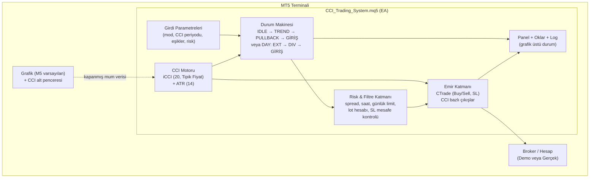
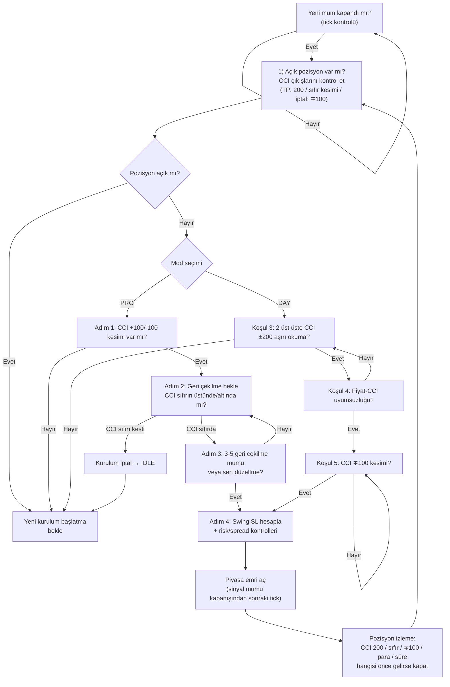
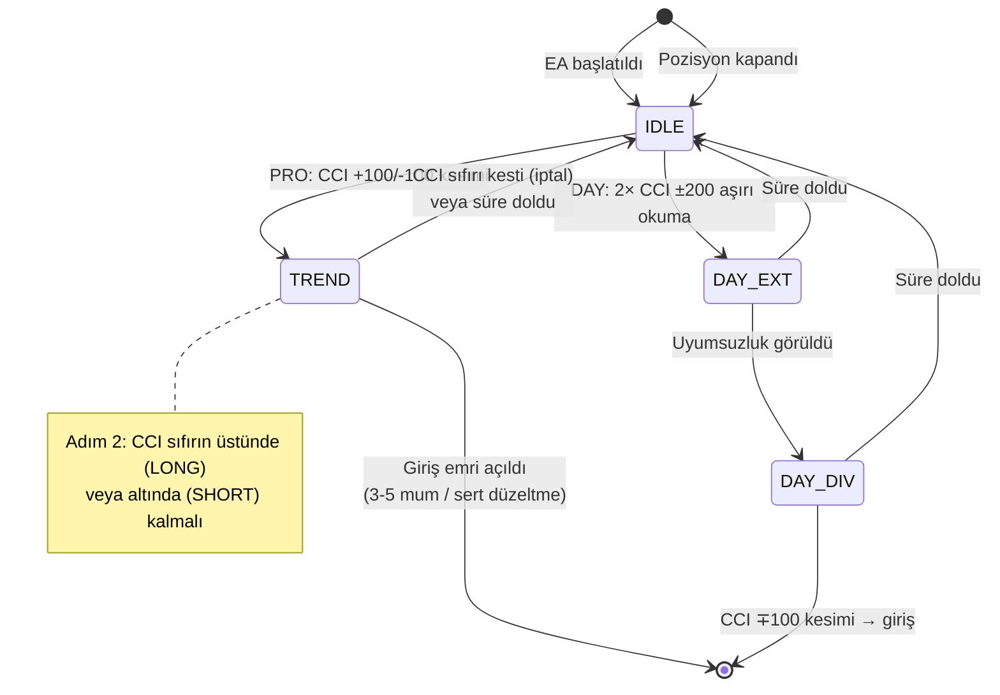

# CCI Trading System — MT5 Tam Otomatik Bot Tasarımı

> **Kaynak:** [Trading Strategy Guides — CCI Trading System](https://tradingstrategyguides.com/cci-trading-system/)
> **Bot dosyası:** `CCI_Trading_System.mq5` (MT5 / MQL5, tam otomatik EA)
> **Bu belge:** Kaynağın detaylı analizi + çıkarılan tasarım şeması + botun kurulum ve kullanım kılavuzu

---

## 1. Kaynak Analizi — Makalede Ne Anlatılıyor?

### 1.1 CCI (Commodity Channel Index) nedir?

- **Yaratıcısı:** Donald Lambert. Başlangıçta emtia piyasalarındaki döngüleri (cycle) tespit etmek için tasarlanmış, sonra hisse, Forex ve kriptoda da kullanılan bir **osilatör**.
- **Mantığı:** Fiyatın kendi ortalamasından ne kadar uzaklaştığını ölçer. Çoğunlukla **+100 ile −100** arasında hareket eder.
  - **+100 üstü** = boğa sinyali, yükseliş trendi başlangıcı
  - **−100 altı** = ayı sinyali, düşüş trendi başlangıcı
- **Sıfır çizgisi** = boğalar ile ayılar arasındaki "çizgi" (line in the sand). Sıfırın üstüne geçiş boğa momentumuna, altına geçiş ayı momentumuna işaret eder.
- Makale CCI'ı **öncü (leading)** gösterge olarak niteler: fiyatın gerisinde kalmaz, döngüleri erken yakalar.
- **Formül:**

```
CCI = (Tipik Fiyat − 20 periyotluk TP SMA'sı) / (0.015 × Ortalama Sapma)
Tipik Fiyat (TP) = (High + Low + Close) / 3
```

  - `0.015` sabiti, CCI değerlerinin çoğunlukla ±100 bandında kalmasını sağlar.
  - Bakış periyodu (look-back) büyüdükçe CCI değerlerinin ±100 bandına düşme oranı artar.

### 1.2 Makalede iki ayrı sistem var (önemli!)

Makale tek bir sistem değil, **iki farklı CCI sistemi** anlatıyor. Bot ikisini de içeriyor ve mod seçimiyle çalışıyor:

| Özellik | **A) Profesyonel Sistem** (makalenin ana sistemi) | **B) Günlük (Day) Sistem** |
|---|---|---|
| Amaç | Trend başlangıcında geri çekilmede (pullback) giriş | Aşırı satım/alım sonrası dönüş (reversal) yakalama |
| Zaman dilimi | Esnek; swing/pozisyon için üst TF önerilir | **M5** (gün içi gürültüyü elemek için) |
| Eşikler | +100 / −100 (trend), 0 (filtre), +200 (TP) | **+200 / −200** (aşırı), −100 / +100 (tetik) |
| Giriş mantığı | Trend + geri çekilme + 3–5 mum | Çift aşırı okuma + uyumsuzluk + kesim |
| Çıkış mantığı | CCI 200 veya sıfır kesimi | CCI ters 200 kesimi |
| SL mantığı | En son swing dip/tepe | Swing dip/tepe (botta aynı mekanizma) |

### 1.3 Profesyonel Sistem — 5 Adım (varsayılan mod: `CCI_MODE_PRO`)

Makalenin "How the Professional Traders use the CCI Indicator Strategy" başlığı altındaki kurallar, LONG örneğiyle:

1. **Adım 1 — Trend başlangıcı:** CCI **+100'ü yukarı keser**. Bu, ortalamanın üstünde güç kazanan yeni bir boğa trendinin/ralinin başlangıcıdır. (SHORT'ta tersi: CCI −100'ü aşağı keser.)
2. **Adım 2 — Geri çekilme filtresi:** Fiyat geri çekilmesini (retracement) bekle. Bu sırada **CCI sıfır çizgisinin üstünde kalmalıdır**. CCI sıfırın altına inerse LONG fikri iptal olur. Makalenin notu: *"CCI ne kadar az geri çekilirse ralli o kadar güçlü olur"* — fiyat CCI'dan daha fazla geri çekilmeli, CCI zayıf geri çekilmeli.
3. **Adım 3 — Giriş tetikleyicisi:** **3–5 mumluk** geri çekilme tamamlanınca al. **Sert düzeltmeler** (sharp correction) varsa kapanış fiyatından hemen al.
4. **Adım 4 — Stop Loss:** En son **swing dip** altına (LONG) / swing tepe üstüne (SHORT). Ek kural: giriş sonrası **CCI −100'ü keserse** (LONG) SL dolmadan piyasadan çık.
5. **Adım 5 — Take Profit:** **CCI +200'e değerse** VEYA **CCI sıfırın altına inerse** — hangisi önce olursa çık. (SHORT'ta: CCI −200 veya sıfır üstü.)

> Makale ayrıca şunu vurgular: CCI'ı **tek başına** kullanma; fiyat aksiyonu ve diğer analizlerle birleştir. Uyumsuzluk (divergence) da izlenmeli. Bot bunu üst TF filtresi ve DAY modundaki uyumsuzluk şartıyla karşılar.

### 1.4 Günlük Sistem — 5 Koşul (mod: `CCI_MODE_DAY`)

1. Tercih edilen TF: **5 dakikalık** grafik
2. Gürültüyü elemek için **+200 / −200** eşikleri kullanılır
3. **İki üst üste** aşırı okuma beklenir (CCI > +200 veya < −200). Makale Bitcoin örneğiyle ilk aşırı okumada girilseydi para kaybedileceğini, bu yüzden iki okumanın şart olduğunu gösterir.
4. **Uyumsuzluk** (divergence): fiyat daha düşük dipler yaparken CCI daha yüksek dipler yapmalı (LONG); tersi SHORT.
5. **CCI −100'ü yukarı kesince** (LONG) tetiklenir. Çıkış: **CCI +200'ü kesince** pozisyon kapatılır.

### 1.5 Makalenin genel tavsiyeleri

- **Zaman dilimi:** Günlük işlemciler M5; swing/pozisyon için **daha yüksek TF'ler daha iyi sonuç verir** (backtest sonucuna göre).
- **Kullanım alanları:** Hisse, Forex, emtia, kripto — hepsinde uygulanabilir.
- **Scalping:** CCI'ın fiyata duyarlılığı kısa vadeli hareketleri yakalamaya uygun.
- **Disiplin:** Sinyali beklemek, erken girip pişman olmamak; "güvenli işlem yap, sonra pişman olma" ilkesi.

---

## 2. Tasarım Şeması

### 2.1 Sistem mimarisi



### 2.2 Ana akış (flowchart)



### 2.3 Durum makinesi (state diagram)



### 2.4 Örnek senaryo — LONG (PRO mod)

```
CCI
 +200 ┤                              ╭─ TP: CCI +200'e değdi → KAPAT
      │                         ╭────╯
 +100 ┤───╲ kesim (Adım 1) ╭───╯
      │    ╲______________╱  ← geri çekilme: CCI sıfırın üstünde
   0  ┤         ╲________╱     (Adım 2) → 3-5 mum sonra GİRİŞ (Adım 3)
      │          SL: swing dip altı (Adım 4)
      └────────────────────────────────────────────► zaman
Fiyat:  tepe → geri çekilme → giriş → yükseliş → CCI sıfır kesimi veya 200 TP
```

---

## 3. Botun Kuralları (otomatikleştirilmiş hali)

### 3.1 PRO mod — LONG / SHORT

| # | Kural | LONG | SHORT |
|---|---|---|---|
| 1 | Trend kesimi | `CCI[2] ≤ +100` ve `CCI[1] > +100` | `CCI[2] ≥ −100` ve `CCI[1] < −100` |
| 2 | Geri çekilme filtresi | Geri çekilme boyunca `CCI > 0` | Geri çekilme boyunca `CCI < 0` |
| 3 | Giriş tetikleyici | ≥ `InpPullbackCandles` (vars. 3) geri çekilme mumu **ve** CCI zirveden geri çekilmiş | Tersi |
| 3b | Sert düzeltme | Gövde > `InpSharpCorrectionATR` × ATR olan ters mum → kapanışta giriş | Tersi |
| 4 | Stop Loss | Kurulumdaki en düşük dip − tampon | Kurulumdaki en yüksek tepe + tampon |
| 4b | İptal çıkışı | Giriş sonrası `CCI < −100` → piyasadan çık | Giriş sonrası `CCI > +100` → çık |
| 5 | Take Profit | `CCI ≥ +200` **veya** CCI sıfır altına keser | `CCI ≤ −200` **veya** CCI sıfır üstüne keser |

### 3.2 DAY mod — LONG / SHORT

| # | Kural | LONG | SHORT |
|---|---|---|---|
| 1–3 | Çift aşırı okuma | `CCI[1] < −200` ve `CCI[2] < −200` | `CCI[1] > +200` ve `CCI[2] > +200` |
| 4 | Uyumsuzluk | Fiyat daha düşük dip, CCI daha yüksek dip | Fiyat daha yüksek tepe, CCI daha düşük tepe |
| 5 | Tetik | `CCI[2] ≤ −100` ve `CCI[1] > −100` | `CCI[2] ≥ +100` ve `CCI[1] < +100` |
| Çıkış | TP | `CCI > +200` kesimi | `CCI < −200` kesimi |
| SL | | Swing dip altı (PRO ile aynı mekanizma) | Swing tepe üstü |

### 3.3 Makalede öznel kalan noktaların otomatikleştirilmesi

Makale insan gözüyle yorum gerektiren kavramlar kullanır. Botun bunları nasıl somutlaştırdığı:

| Makaledeki ifade | Botun otomatik tanımı |
|---|---|
| "Geri çekilme mumu" | Kapanışı açılışından **veya** bir önceki kapanıştan düşük olan mum (LONG); SHORT'ta tersi |
| "3–5 mumluk geri çekilme" | Kurulum başlangıcından beri sayılan geri çekilme mumları ≥ `InpPullbackCandles` |
| "Sert düzeltme" | Gövdesi `InpSharpCorrectionATR` (vars. 1.5) × ATR'den büyük ters yönlü mum |
| "En son swing dip/tepe" | Kurulum başlangıcından beri görülen en düşük dip / en yüksek tepe, `InpSLBufferPoints` tamponuyla |
| "Uyumsuzluk" | Bakış penceresinin son yarısı ile önceki yarısının dip/tepe ve CCI değerlerinin karşılaştırılması |
| "CCI 200'e değerse" | Kapanmış mum CCI'ı `≥ +200` (LONG) / `≤ −200` (SHORT) |
| "Kapanış fiyatından al" | Sinyal mumu kapandıktan sonraki ilk tick'te piyasa emri |

> **Önemli:** Bu tanımlar makalenin ruhuna sadık kalınarak seçilmiş **yorum kararlarıdır**. Farklı bir yorum isterseniz ilgili girdilerle (özellikle `InpPullbackCandles`, `InpSharpCorrectionATR`, `InpDivergenceLookback`) ayarlanabilir.

---

## 4. Parametreler

### 4.1 Strateji ve CCI

| Parametre | Varsayılan | Açıklama |
|---|---|---|
| `InpMode` | `CCI_MODE_PRO` | `PRO` = profesyonel 5 adım, `DAY` = günlük 5 koşul |
| `InpTimeframe` | `PERIOD_CURRENT` | İşlem TF'i; DAY için **M5** önerilir |
| `InpCCIPeriod` | `20` | CCI periyodu (makale formülü 20) |
| `InpAppliedPrice` | `PRICE_TYPICAL` | Tipik Fiyat (makale formülü) |
| `InpTrendLevel` | `100` | Trend eşiği (±100) |
| `InpTakeProfitLevel` | `200` | CCI TP eşiği (±200) |
| `InpExtremeLevel` | `200` | DAY aşırı eşiği (±200) |
| `InpPullbackCandles` | `3` | Giriş için geri çekilme mumu (makale: 3–5) |
| `InpMaxSetupBars` | `20` | Kurulum geçerlilik süresi (0 = sınırsız) |
| `InpSharpCorrectionATR` | `1.5` | Sert düzeltme ATR katı (0 = kapalı) |
| `InpUseHTFFilter` | `false` | Üst TF CCI filtresi (makale: üst TF daha iyi) |
| `InpHTFTimeframe` / `InpHTFCCIPeriod` | `H1` / `20` | Üst TF ve CCI periyodu |

### 4.2 DAY mod

| Parametre | Varsayılan | Açıklama |
|---|---|---|
| `InpRequireDivergence` | `true` | Uyumsuzluk şartı açık/kapalı |
| `InpDivergenceLookback` | `20` | Uyumsuzluk bakış penceresi (mum) |
| `InpConsecutiveExtremeBars` | `2` | Üst üste aşırı okuma sayısı |

### 4.3 Pozisyon ve risk

| Parametre | Varsayılan | Açıklama |
|---|---|---|
| `InpLotSize` | `0.01` | Sabit lot |
| `InpUseRiskPercent` / `InpRiskPercent` | `false` / `1.0` | SL mesafesine göre risk % ile lot |
| `InpMagicNumber` | `20261116` | Magic number |
| `InpMaxSpreadPoints` | `0` | Maks. spread (0 = kapalı) |
| `InpMaxOpenPositions` | `1` | Maks. açık pozisyon (0 = sınırsız) |
| `InpTradeMode` | `0` | **İşlem modu**: `0` = düz, `1` = ters, `2` = düz + ters aynı anda |
| `InpMagicMirror` | `0` | Ters işlemler için magic numarası (0 = `InpMagicNumber` + 1) |
| `InpMaxSL_ATR` | `3.0` | SL mesafesi bu ATR katını aşarsa işlem atlanır |
| `InpSLBufferPoints` | `10` | Swing SL tamponu (point) |
| `InpFixedTpPoints` / `InpFixedSlPoints` | `0` / `0` | Sabit TP/SL (0 = kapalı; varsayılan CCI/swing) |
| `InpMoneyTakeProfit` / `InpMoneyStopLoss` | `0` / `0` | Para bazlı çıkışlar (0 = kapalı) |
| `InpMaxPositionMinutes` | `0` | Maks. pozisyon süresi (0 = kapalı) |
| `InpMoveToBEAtCCI` | `0` | CCI bu seviyede SL'yi BE'ye çeker (0 = kapalı) |

### 4.4 Filtreler ve görsel

| Parametre | Varsayılan | Açıklama |
|---|---|---|
| `InpUseTradingHours` / `InpStartHour` / `InpEndHour` | `false` / `0` / `24` | İşlem saatleri (sunucu saati) |
| `InpMaxTradesPerDay` | `0` | Günlük maks. işlem (0 = sınırsız) |
| `InpMaxDailyLoss` | `0` | Günlük maks. zarar (0 = kapalı) |
| `InpDrawArrows` / `InpShowPanel` / `InpLogSignals` | `true` / `true` / `false` | Oklar, panel, log |

---

## 5. Kurulum ve Kullanım

### 5.1 Kurulum (MT5)

1. MT5'i açın → **Dosya (File) → Veri Klasörünü Aç (Open Data Folder)**
2. `MQL5/Experts/` klasörüne `CCI_Trading_System.mq5` dosyasını kopyalayın
3. MT5'te **Navigator (Ctrl+N)** → Expert Advisors altında botu bulun
4. Grafiğe sürükleyin (önerilen: **M5** grafiği, örn. EURUSD veya BTCUSD)
5. Parametreleri kontrol edin → **"Algo Trading" (Algo İşlem)** düğmesinin açık olduğundan emin olun
6. Bot çalışmaya başlar; grafik üstünde durum paneli görünür

### 5.2 Strategy Tester (geriye dönük test)

1. **Ctrl+R** → Expert Advisor: `CCI_Trading_System`
2. Sembol ve tarih aralığını seçin (en az 6–12 ay önerilir)
3. Model: **"Every tick based on real ticks"** (en gerçekçi)
4. İleri test / optimizasyon için `InpPullbackCandles`, `InpCCIPeriod`, `InpTrendLevel` aralıklarını kullanın
5. Sonuçları **Graph / Equity / Journal** sekmelerinden inceleyin; aşırı optimizasyon (overfitting) yapmayın

### 5.3 Hazır preset

- `CCI_Pro_M5.set` — PRO mod, M5, varsayılan makale parametreleri
- `CCI_Day_M5.set` — DAY mod, M5, uyumsuzluklu

Preset yüklemek için: EA parametreleri → **Load (Yükle)** → `.set` dosyasını seçin.

---

## 6. İşlem Modu: Düz / Ters / Düz + Ters (aynı anda)

Tek bir parametre (`InpTradeMode`) üç çalışma biçimi sunar:

| Değer | Mod | Davranış |
|---|---|---|
| `0` | Düz | Sinyal yönünde işlem (klasik) |
| `1` | Ters | BUY sinyali → SELL, SELL sinyali → BUY; SL/TP mesafeleri yer değiştirir |
| `2` | Düz + Ters | **Her sinyalde iki yönlü emir açılır:** düz emir ana magic ile, ters emir ikinci magic ile; iki pozisyon birbirinden bağımsız yönetilir |

### Ayrı yönetim nasıl sağlanır?

- Düz işlemler `InpMagicNumber`, ters işlemler `InpMagicMirror` (0 ise `InpMagicNumber + 1`) magic numarasını kullanır.
- Her pozisyon **kendi yönüne ve kendi magic'ine göre** yönetilir: strateji çıkışları, SL/TP, başabaş takibi (`InpMoveToBEAtRR`) ve kısmi kâr seviyeleri mod bazında ayrı tutulur.
- `InpMaxOpenPositions` mod 2'de **yön başına** uygulanır (ör. 1 → en fazla 1 düz + 1 ters). Tek modlarda eski davranış korunur (toplam pozisyon).
- Panelde `[MOD: DUZ]`, `[MOD: TERS]` veya `[MOD: DUZ+TERS]` görünür; uzman günlüğüne mod ve iki magic numarası yazılır.

### SL/TP aynalaması (ters taraf)

| Konu | Düz taraf | Ters taraf |
|---|---|---|
| Sinyal yönü | BUY → BUY, SELL → SELL | BUY → **SELL**, SELL → **BUY** |
| Stop Loss | stratejinin SL seviyesi | **eski TP mesafesinde** (girişin diğer tarafında) |
| Take Profit | stratejinin TP seviyesi | **eski SL mesafesinde** |
| TP'siz (gösterge çıkışlı) stratejiler | SL + gösterge çıkışı | SL girişe göre aynalanır; gösterge çıkışları pozisyon yönüne göre otomatik ters çalışır |
| Bekleyen emirler | limit / stop | **limit ↔ stop** (seviye piyasanın doğru tarafında kalır) |
| Kısmi kâr (TP1) | TP1 + TP2 | SL ↔ en uzak hedef yer değişir, TP1 mesafesi SL'den gelir |

Sinyal/giriş koşulları, seviye hesapları ve trend/spread/saat filtreleri **hiç değişmez**; yalnızca emir gönderilirken yön ve SL/TP mesafeleri çevrilir. `InpAllowLongs` / `InpAllowShorts` ve maks. SL (`InpMaxSL_ATR`) filtreleri **işleme girecek gerçek yöne** uygulanır. Hazır `.set` dosyalarında `InpTradeMode=0` ve `InpMagicMirror=0` gelir.

> ⚠️ **Mod 1 ve 2'de risk/ödül tersine döner:** orijinal strateji 20 pip SL / 40 pip TP kullanıyorsa ters taraf 40 pip SL / 20 pip TP ile çalışır. Ayrıca ters tarafta SL mesafesi orijinalin TP mesafesi olduğu için `InpMaxSL_ATR` filtresi normalden sık devreye girebilir; gerekirse gevşetin.
>
> ⚠️ **Mod değiştirmeden önce açık pozisyonları kapatın.** Mod 2'den çıkarsanız ikinci magic ile açılmış pozisyonların başabaş/kısmi kâr referansları geçersiz kalır (pozisyonlar yine de SL/TP ve strateji çıkışlarıyla yönetilir).

## 7. Risk ve Sınırlamalar

- **Bu bir yatırım tavsiyesi değildir.** Forex/kripto kaldıraçlı işlemler yüksek risk taşır; önce **demo hesapta** test edin.
- Bot **martingale/grid yapmaz**; tek pozisyon disiplinindedir. Bu, makalenin "güvenli işlem" ilkesine uygun bilinçli bir seçimdir.
- Sinyaller **kapanmış mum** bazlıdır; sinyal mumu kapanışından sonraki ilk tick'te girilir. Hızlı piyasada kayma (slippage) olabilir.
- EA yeniden başlatılırsa **kurulum durumu sıfırlanır** (IDLE); ancak açık pozisyonların CCI çıkışları durumdan bağımsız çalışmaya devam eder.
- Makalenin öznel kavramları (geri çekilme, swing, uyumsuzluk) için seçilen otomatik tanımlar bölüm 3.3'te belgelenmiştir; strateji tester ile doğrulama önerilir.
- Geçmiş performans gelecekteki sonuçları garanti etmez.

---

## 8. Dosya Listesi

| Dosya | Açıklama |
|---|---|
| `CCI_Trading_System.mq5` | Tam otomatik MT5 robotu (PRO + DAY mod) |
| `README_CCI_Bot.md` | Bu belge: analiz + tasarım şeması + kılavuz |
| `CCI_Pro_M5.set` | PRO mod M5 preset |
| `CCI_Day_M5.set` | DAY mod M5 preset |

---

## 9. Kaynakça

- Trading Strategy Guides, *CCI Trading System: How The Pro's Trade* —
  <https://tradingstrategyguides.com/cci-trading-system/>
- Donald Lambert, Commodity Channel Index (CCI) — StockCharts referansı (makalede atıf)
