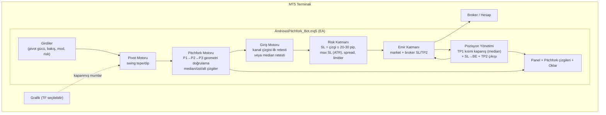
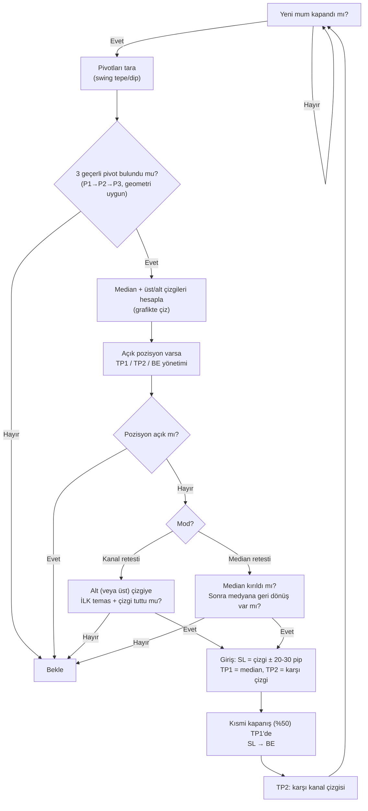
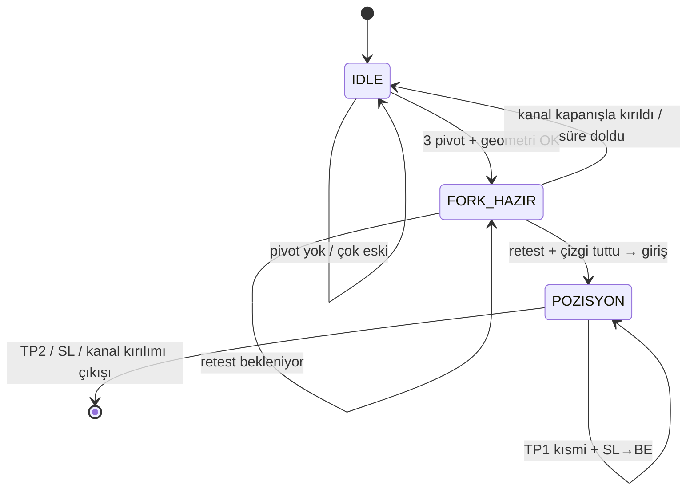

# Andrews Pitchfork — MT5 Tam Otomatik Bot Tasarımı

> **Kaynak:** [Trading Strategy Guides — Andrews Pitchfork Trading Strategy](https://tradingstrategyguides.com/andrews-pitchfork-trading-strategy/)
> **Bot dosyası:** `AndrewsPitchfork_Bot.mq5` (MT5 / MQL5, tam otomatik EA)
> **Bu belge:** Kaynağın detaylı analizi + çıkarılan tasarım şeması + botun kurulum ve kullanım kılavuzu

---

## 1. Kaynak Analizi — Makalede Ne Anlatılıyor?

### 1.1 Andrews Pitchfork nedir?

- **3–5 paralel çizgi** ile dinamik destek/direnç üreten klasik bir teknik analiz aracı.
- Ortadaki çizgi **median line**'dır. Üstünde iki direnç, altında iki destek çizgisi bulunur (temel kullanımda **3 çizgi**).
- **Temel teori:** Median çizgi kırılırsa, ~%80 olasılıkla fiyat **kanalın karşı tarafını** test eder.
  - Median yukarı kırılırsa → kanalın **üstünü** test eder.
  - Median aşağı kırılırsa → kanalın **altını** test eder.
- Fiyat **median çizgisine yönelir** (gravitates) → median hem destek hem dirençtir; bir **regresyon çizgisi** gibi davranır.
- Sistem üç güçlü yaklaşımı birleştirir: **destek/direnç + trend takibi + ortalamaya dönüş**.
- Her zaman diliminde ve her piyasada uygulanabilir.

### 1.2 Çizim mantığı (3 pivot)

- Pitchfork **üç pivot** gerektirir. Pivot = fiyatın belirgin şekilde tepki verdiği swing tepe veya dip.
- Çizim: **Pivot 1 → Pivot 2 → Pivot 3** sırasıyla ilerlenir.
  - **Median line:** P1'den geçer ve **P2–P3 orta noktasına** uzanır.
  - **Üst/alt paralel çizgiler:** P2 ve P3'ten geçer.
- Makale açıkça belirtir: *"Seçilen pivot noktaları bir ölçüde özneldir"* → farklı senaryolar test edilebilir.

### 1.3 Makalenin ALIM kuralları (5 adım; SATIM tam tersi)

| # | Adım | Açıklama |
|---|---|---|
| 1 | **Üç pivotu bul** | Alım için **yükselen** pivot serisi (P1 dip → P2 tepe → P3 daha yüksek dip) |
| 2 | **Pitchfork'u çiz** | P1'den P2 ve P3 üzerinden; dinamik destek/direnç haritası |
| 3 | **Alt kanal destek çizgisinin İLK retestinde piyasa fiyatından AL** | Fiyat kanal içinde kalır; alt çizgi destek olarak çalışır |
| 4 | **TP1 median'da kismi kâr, TP2 üst direnç çizgisinde** | TP1 sonrası **SL'yi BE'ye çek** (kârı kilitle, riske atma) |
| 5 | **SL: alt kanal çizgisinin 20–30 pip altı** | Yanlış kırılımlara (false breakout) karşı tampon |

**Notlar (makale):**
- Güçlü yükseliş trendinde fiyat **üst çizgiyi yukarı kırması normaldir**; güçlü düşüşte alt çizgi aşağı kırılır. Yani çizgi kırılımı tek başına dönüş sinyali değildir; trend gücünü gösterir.
- SATIM örneği "price failure rule" ile verilmiştir (görselde).

### 1.4 Sistemin 3 temel ilkesi (makalenin özeti)

1. Fiyat **median çizgisine yönelir**.
2. Median kırıldığında, fiyatın **median'ı yeniden test etme** olasılığı yüksektir.
3. Fiyat kanalı **ters yönde** kırarsa **piyasa duygusu değişir**, trend dönebilir.

---

## 2. Tasarım Şeması

### 2.1 Geometri (botun hesabı)

```
Fiyat
        ╱  ← üst kanal çizgisi (P2'den geçen paralel)          TP2 (BUY)
      ╱ ─────────────────────────────────────────────
    ╱   ← median (P1 → P2/P3 orta noktası)                  TP1 (kismi)
  ╱ ───────────────────────────────────────────────
╱       ← alt kanal çizgisi (P3'ten geçen paralel)   ← GİRİŞ (ilk retest)
P3 ●                                                    SL = alt çizgi − 20..30 pip
    ╲
     ● P1        ● P2
   (P1: en eski pivot, P3: en yeni pivot)
```

Formüller (bar indeksi `t`, 0 = güncel bar):

```
tM = (t2 + t3) / 2            pM = (p2 + p3) / 2
eğim (bar başına)  s = (pM − p1) / (t1 − tM)
median(t) = p1 + s · (t1 − t)
üst(t)    = p2 + s · (t2 − t)      (yükselen fork)
alt(t)    = p3 + s · (t3 − t)
```

### 2.2 Sistem mimarisi



### 2.3 Ana akış



### 2.4 Durum akışı



---

## 3. Botun Kuralları (otomatikleştirilmiş hali)

### 3.1 Adım adım

| Adım | Makale | Botun uygulaması |
|---|---|---|
| 1 | Üç pivotu bul | `InpPivotStrength` kadar bar sağında/solunda ekstrem olan swing tepe/dip; yükselen (dip-tepe-dip, P3 > P1) veya düşen (tepe-dip-tepe, P3 < P1) sıra doğrulanır |
| 2 | Pitchfork'u çiz | Median = P1 → (P2+P3)/2; üst/alt çizgiler P2 ve P3'ten geçen paraleller (grafikte 3 çizgi çizilir) |
| 3 | Alt çizginin ilk retestinde AL | Bar fitili alt çizgiye `InpLineToleranceATR × ATR` kadar yaklaşır ve kapanış **çizginin üstünde** kalırsa AL; P3'ten sonra daha önce temas veya kapanışla kırılma olduysa kurulum iptal |
| 4 | TP1 median (kısmi), TP2 üst çizgi | Giriste TP1/TP2 seviyeleri sabitlenir; fiyat TP1'e ulaşınca `InpPartialClosePercent` kadar kısmi kapanış + **SL → BE**; TP2'de kalan kapanır |
| 5 | SL = çizgi − 20–30 pip | `InpSLBufferPips` (vars. 25) tampon; ayrıca `InpMaxSL_ATR` ile aşırı geniş SL filtrelenir |

SATIM: aynı kuralların tersi (üst çizgi retesti, SL üst çizgi + tampon, TP1 median, TP2 alt çizgi).

### 3.2 İki giriş modu

| Mod | Kural | Kullanım |
|---|---|---|
| `PF_LINE_RETEST` (varsayılan) | Kanal çizgisinin **ilk retesti** — makalenin Adım 3'ü | Trend takibi |
| `PF_MEDIAN_RETEST` | Median kırıldıktan sonra fiyatın medyana **geri dönüşü** — makalenin 2. ilkesi | Ortalamaya dönüş |

### 3.3 Öznel noktaların otomasyonu

| Makaledeki ifade | Botun otomatik tanımı |
|---|---|
| "Pivot = fiyatın belirgin tepki verdiği swing tepe/dip" | `InpPivotStrength` (vars. 3) bar sağında/solunda **en yüksek/en düşük** olan bar |
| "Pivot seçimi özneldir" | Pivotlar ve geometri (yükselen/düşen sıra, eğim işareti, min. span) deterministik kurallarla seçilir; `InpPivotStrength` ile ayarlanır |
| "Erken trend aşaması" | `InpMaxForkAgeBars` (P3 tazeliği) + `InpLookbackBars` penceresi |
| "İlk retest" | P3'ten sonraki barlarda çizgiye **ilk** temas; öncesinde temas/kırılma varsa iptal |
| "Çizgi tuttu" | Fitil çizgiye `InpLineToleranceATR × ATR` mesafede değdi + kapanış doğru tarafta |
| "Kısmi kâr median'da" | `InpPartialClosePercent` (vars. %50) kısmi kapanış |
| "TP1 sonrası SL'yi BE'ye çek" | `InpMoveToBEAfterTP1` (vars. açık) |
| "TP2 kanalın diğer ucu" | Broker TP = giriş anındaki karşı çizgi değeri (gösterge çizgisi hareket etse bile kâr alınır) |
| "20–30 pip tampon" | `InpSLBufferPips` (vars. 25; aralık dışında uyarı) |
| "Ters yönde kanal kırılımı = duygu değişimi" | `InpExitOnChannelBreak` (vars. kapalı) + kanal kırıldığında fork geçersiz sayılır |

---

## 4. Parametreler

### 4.1 Pitchfork

| Parametre | Varsayılan | Açıklama |
|---|---|---|
| `InpTimeframe` | `PERIOD_CURRENT` | İşlem zaman dilimi |
| `InpPivotStrength` | `3` | Pivot için her iki yanda bar sayısı |
| `InpLookbackBars` | `400` | Pivot tarama penceresi |
| `InpMaxForkAgeBars` | `200` | P3 en fazla kaç bar önce oluşmalı |
| `InpMinForkSpanBars` | `20` | P1–P3 arası min. bar |
| `InpMaxWaitRetestBars` | `80` | Kurulum geçerlilik süresi |

### 4.2 Giriş

| Parametre | Varsayılan | Açıklama |
|---|---|---|
| `InpEntryMode` | `PF_LINE_RETEST` | `0` kanal çizgisi ilk retesti · `1` median retesti |
| `InpLineToleranceATR` | `0.15` | Çizgiye temas toleransı (ATR katı) |

### 4.3 Çıkış

| Parametre | Varsayılan | Açıklama |
|---|---|---|
| `InpPartialClosePercent` | `50` | TP1'de kısmi kapanış (%) |
| `InpMoveToBEAfterTP1` | `true` | TP1 sonrası SL → BE |
| `InpSLBufferPips` | `25` | SL tamponu (pip, makale 20–30) |
| `InpExitOnChannelBreak` | `false` | Ters yönde kanal kırılımında kapat |
| `InpUseFixedTP` | `true` | Broker TP = TP2 |

### 4.4 Pozisyon / risk / filtre

| Parametre | Varsayılan | Açıklama |
|---|---|---|
| `InpLotSize` / `InpUseRiskPercent` / `InpRiskPercent` | `0.01` / `false` / `1.0` | Lot ve risk % |
| `InpMagicNumber` | `20261120` | Magic (diğer botlardan farklı) |
| `InpDeviationPoints` / `InpMaxSpreadPoints` | `20` / `0` | Sapma ve spread filtresi |
| `InpMaxOpenPositions` | `1` | Maks. açık pozisyon |
| `InpAllowLongs` / `InpAllowShorts` | `true` / `true` | Yön izinleri |
| `InpMaxSL_ATR` | `5.0` | Bu ATR katını aşan SL'de işlem atlanır |
| `InpMoneyTakeProfit` / `InpMoneyStopLoss` | `0` / `0` | Para bazlı çıkışlar |
| `InpMaxPositionMinutes` | `0` | Maks. pozisyon süresi |
| `InpMoveToBEAtRR` | `0.0` | Kâr R×N olunca SL → BE |
| `InpUseTradingHours` / `InpStartHour` / `InpEndHour` | `false` / `0` / `24` | İşlem saatleri |
| `InpMaxTradesPerDay` / `InpMaxDailyLoss` | `0` / `0` | Günlük limitler |
| `InpDrawFork` / `InpDrawForwardBars` | `true` / `20` | Çizim ve ileri uzatma |
| `InpDrawArrows` / `InpShowPanel` / `InpDeleteOnExit` / `InpLogSignals` | `true` / `true` / `true` / `false` | Görsel ve log |

---

## 5. Kurulum ve Kullanım

### 5.1 Kurulum (MT5)

1. MT5 → **Dosya → Veri Klasörünü Aç**
2. `MQL5/Experts/` içine `AndrewsPitchfork_Bot.mq5` kopyala
3. **Ctrl+N** → Expert Advisors → grafiğe sürükle (önerilen: **H4 veya D1**)
4. **Algo Trading** açık olsun
5. Grafikte **median (altın), üst (kırmızı), alt (yeşil)** çizgileri görünür; panelde P1/P2/P3, eğim ve seviyeler yazar

### 5.2 Strategy Tester

1. **Ctrl+R** → EA: `AndrewsPitchfork_Bot`
2. En az 6–12 ay (H4) veya 2–5 yıl (D1); model: **"Every tick based on real ticks"**
3. Optimizasyon: `InpPivotStrength`, `InpLookbackBars`, `InpMaxForkAgeBars`, `InpSLBufferPips`, `InpPartialClosePercent`, `InpEntryMode` (0/1)
4. TP1 kısmi kapanış kapalı/açık karşılaştırması yapın — makalenin kâr yönetimi buradadır

### 5.3 Hazır preset'ler

| Dosya | Ayar |
|---|---|
| `Pitchfork_H4_LineRetest.set` | H4, kanal çizgisi ilk retesti |
| `Pitchfork_D1_MedianRetest.set` | D1, median retesti (max SL 6×ATR) |
| `Pitchfork_M30_LineRetest.set` | M30, daha küçük pivotlar (2), 20 pip tampon |

Yükleme: EA parametreleri → **Load** → `.set` dosyası.

---

## 6. Risk ve Sınırlamalar

- **Yatırım tavsiyesi değildir.** Kaldıraçlı işlemlerde ciddi kayıp riski vardır; **önce demo**.
- Pivot seçimi makalede de **öznel**dir; bot bunu deterministik hale getirir ama farklı pivot güçleri farklı fork'lar üretir → **tester ile doğrulama şart**.
- Pitchfork çizgileri **her yeni barda yeniden hesaplanır**; yeni bir pivot oluşursa fork değişebilir. Açık pozisyonun SL/TP seviyeleri girişte sabitlendiği için sonradan kaymaz.
- TP2, giriş anındaki karşı çizgi değeri olarak **sabitlenir**; çizgi sonradan genişlerse kâr potansiyelinin bir kısmı masada kalabilir (makale çizgiyi canlı kullanır).
- Kısmi kapanış broker'ın minimum lot adımına takılırsa (çok küçük lot) TP1 atlanır ve SL BE'ye çekilmez.
- Broker TP kullanıldığı için EA kapalı olsa bile TP2/SL çalışır.
- Makalenin "%73 kazanma oranı" iddiası **pazarlama başlığıdır**; gerçek sonuç piyasa, TF, spread ve parametrelere bağlıdır.
- Geçmiş performans gelecekteki sonuçları garanti etmez.

---

## 7. Dosya Listesi

| Dosya | Açıklama |
|---|---|
| `AndrewsPitchfork_Bot.mq5` | Tam otomatik MT5 robotu (v1.00) |
| `README_Pitchfork_Bot.md` | Bu belge: analiz + tasarım + kılavuz |
| `Pitchfork_H4_LineRetest.set` | H4 kanal retesti preset'i |
| `Pitchfork_D1_MedianRetest.set` | D1 median retesti preset'i |
| `Pitchfork_M30_LineRetest.set` | M30 kanal retesti preset'i |

---

## 8. Kaynakça

- Trading Strategy Guides, *Andrews Pitchfork Trading Strategy: Incredible 73% Win Rate!* —
  <https://tradingstrategyguides.com/andrews-pitchfork-trading-strategy/>
- Makalede referans verilen TSG içerikleri: Support and Resistance Trading Strategy, Rectangle Chart Pattern, Trend Line Trading.
