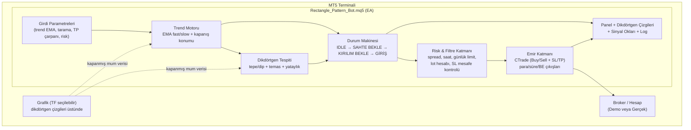
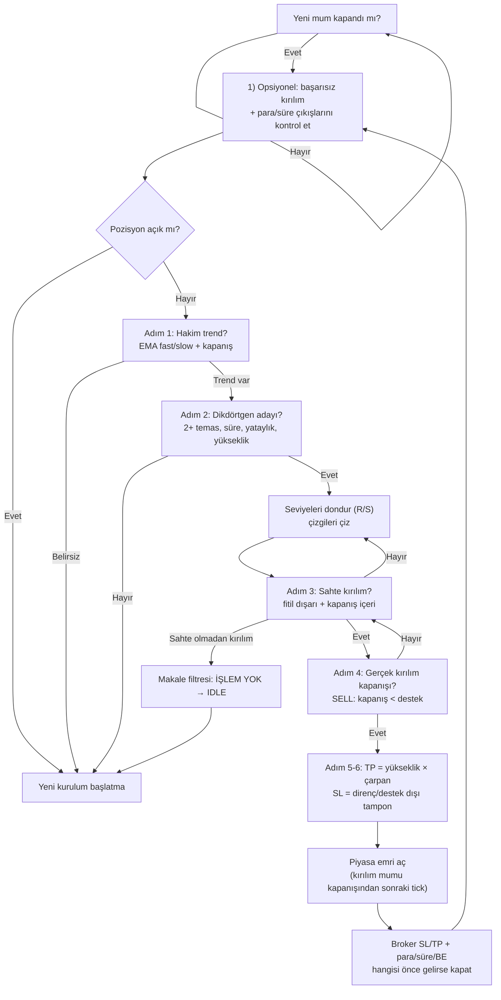
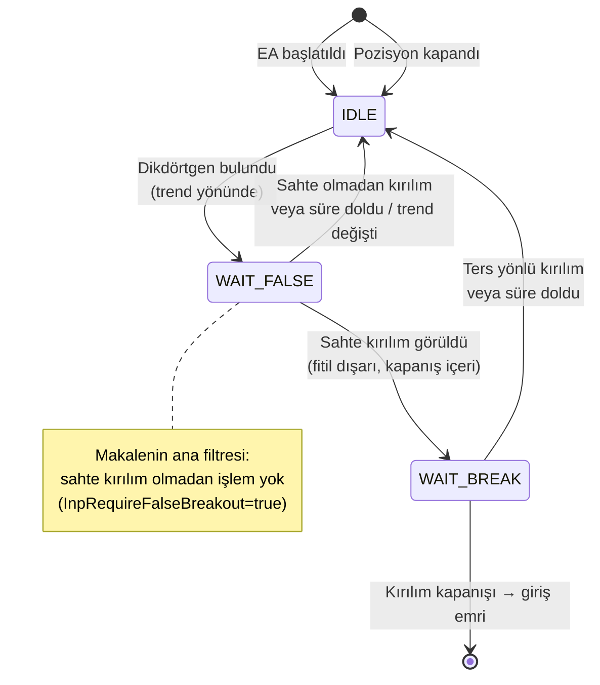

# Rectangle Chart Pattern — MT5 Tam Otomatik Bot Tasarımı

> **Kaynak:** [Trading Strategy Guides — Rectangle Chart Pattern Strategy](https://tradingstrategyguides.com/rectangle-chart-pattern-strategy/)
> **Bot dosyası:** `Rectangle_Pattern_Bot.mq5` (MT5 / MQL5, tam otomatik EA)
> **Bu belge:** Kaynağın detaylı analizi + çıkarılan tasarım şeması + botun kurulum ve kullanım kılavuzu

---

## 1. Kaynak Analizi — Makalede Ne Anlatılıyor?

### 1.1 Rectangle (Dikdörtgen) pattern nedir?

- Fiyatın **iki yatay çizgi** (destek altta, direnç üstte) arasında hareket ettiği, dikdörtgen şekli oluşturan klasik bir fiyat aksiyonu formasyonudur.
- **Hem devam (continuation) hem dönüş (reversal)** sinyali olabilir; ancak makale, trend yönünde kullanıldığında **daha güçlü** olduğunu vurgular: *"yüksek olasılıklı işlem her zaman hakim trend yönündedir."*
- Formasyon oluşurken **nötrdür** (boğa/ayı yanlılığı yok); yön, kırılım olana kadar bilinmez.
- **Tüm zaman dilimlerinde aynı sıklıkta** oluşur — scalping'den swing'e her stil kullanabilir.
- Göstergelerin aksine **gerçek zamanlı** bir araçtır (gecikmeli değildir).

### 1.2 Psikoloji (makalenin "secret sauce" mantığı)

- Dikdörtgen içi = **konsolidasyon**: ne boğalar ne ayılar kontrolde.
- Perakende yatırımcılar konsolidasyon içinde stop'larını destek/direnç dışına koyar → bu seviyelerde **stop'lar birikir**.
- Kurumsal yatırımcılar büyük emirleri için bu likiditeye ihtiyaç duyar.
- **Sahte kırılım (false breakout)** iki iş yapar: ① trend yönündeki stop'ları temizler, ② kırılım alan alıcıları tuzağa düşürür. İkisi de gerçek kırılımda **aşağı (veya yukarı) momentumu besler**. Bu yüzden makale *"yalnızca yüksek olasılıklı dikdörtgenleri"* işlemeyi önerir.

### 1.3 Makalenin 6 Adımı (SELL örneği; BUY tam tersi)

| # | Adım | SELL kuralı | BUY kuralı (tersi) |
|---|---|---|---|
| 1 | **Hakim trend** | Öncesinde **düşüş trendi** olmalı | Öncesinde **yükseliş trendi** olmalı |
| 2 | **Dikdörtgen tespiti** | Fiyat yatay destek/direnç arasında; en az **iki eşit/yakın dip ve tepe** | Aynı |
| 3 | **Sahte kırılım** | Direnç **üzerinde** sahte kırılım bekle | Destek **altında** sahte kırılım bekle |
| 4 | **Giriş** | **Kırılım mumunun kapanışıyla** sat (kapanış destek altında) | Kırılım mumunun kapanışıyla al (kapanış direnç üstünde) |
| 5 | **Take Profit** | Dikdörtgen yüksekliğinin **2–3 katı** (üstten alta ölçülür) | Aynı (kırılım noktasına eklenir) |
| 6 | **Stop Loss** | Direnç seviyesinin **hafif üstüne** | Destek seviyesinin **hafif altına** |

> Makale ayrıca: *"Yönü tahmin etme, fiyat söylesin"* der — kırılım mumunun kapanışı trendin devam edeceğini doğrular. SL'nin dar olması, riskin küçük tutulmasını sağlar (risk-ödül oranı vurgusu).

---

## 2. Tasarım Şeması

### 2.1 Sistem mimarisi



### 2.2 Ana akış (flowchart)



### 2.3 Durum makinesi (state diagram)



### 2.4 Örnek senaryo — SHORT (düşüş trendi)

```
Fiyat
 Direnç (R) ┤─ ─ ─ ─ ─ ─╱╲─ ─ ─ ─ ─ ─ ─ ─ ─ ─ ─ ─ ─ ─ ─
            │  temas   ╱  ╲ sahte kırılım (fitil üstte,
 Destek (S) ┤─ ─ ─ ─ ─╱────╲─ ─ ─ ─ ─ ─ ─ ─ ─ ─ ─ ─ ─ ─
            │         kapanış içeri döndü
            │                              ╲ kapanış < S → SAT
            │                               ╲
 SL: R üstü ┤                                ╲ TP: giriş − 2×yükseklik
            └────────────────────────────────────────────► zaman
Trend: düşüş (EMA20 < EMA50, kapanış EMA50 altında)
```

---

## 3. Botun Kuralları (otomatikleştirilmiş hali)

### 3.1 SHORT / LONG kuralları

| # | Kural | SHORT | LONG |
|---|---|---|---|
| 1 | Trend | EMA20 < EMA50 ve kapanış < EMA50 | EMA20 > EMA50 ve kapanış > EMA50 |
| 2 | Dikdörtgen | Son `InpLookbackBars` mumda en yüksek tepe (R) / en düşük dip (S); her tarafta ≥ `InpMinTouches` temas; temaslar arası ≥ `InpMinDurationBars`; yükseklik ≥ `InpMinHeightATR`×ATR; iki yarı yataylık kontrolü | Aynı |
| 3 | Sahte kırılım | Fitil > R + tampon **ve** kapanış < R | Fitil < S − tampon **ve** kapanış > S |
| 4 | Giriş | Kapanış < S (destek altı) | Kapanış > R (direnç üstü) |
| 5 | TP | Giriş − `InpTPMultiplier` × yükseklik | Giriş + `InpTPMultiplier` × yükseklik |
| 6 | SL | R + `InpSLBufferPoints` | S − `InpSLBufferPoints` |

### 3.2 Makalede öznel kalan noktaların otomatikleştirilmesi

| Makaledeki ifade | Botun otomatik tanımı |
|---|---|
| "Hakim trend" | EMA(fast)/EMA(slow) ilişkisi + kapanışın EMA(slow) altında/üstünde olması (makale gösterge vermez; `InpTrendFastEMA`/`InpTrendSlowEMA` ile ayarlanır) |
| "İki eşit/yakın dip ve tepe" | Yükseklik toleransı (`InpTouchTolerancePct`, vars. %15) içinde kalan temas sayımı, her tarafta ≥ `InpMinTouches` |
| "Yatay hareket" | Pencerenin iki yarısının tepe/dip farkı yükseklik×`InpFlatnessPct` içinde (trend kanalı elenir) |
| "Sahte kırılım" | Fitili tampon (`InpFalseBufferPoints`) kadar dışarı taşan ama kapanışı içeri dönen mum |
| "Kırılım mumunun kapanışı" | Kapanmış mumun kapanışı destek/direnç dışında (giriş bir sonraki tick'te) |
| "2–3 kat TP" | `InpTPMultiplier` (vars. 2.0; makale aralığı 2–3) × dikdörtgen yüksekliği, giriş fiyatından |
| "SL hafif üstte/altta" | Direnç/destek dışı `InpSLBufferPoints` tamponu |

> **Önemli:** Bu tanımlar makalenin ruhuna sadık kalınarak seçilmiş **yorum kararlarıdır**. Özellikle trend tanımı makalede tanımsızdır; farklı bir trend yorumunuz varsa EMA periyotlarıyla veya `InpUseTrendFilter=false` ile test edin.

---

## 4. Parametreler

### 4.1 Trend ve dikdörtgen tespiti

| Parametre | Varsayılan | Açıklama |
|---|---|---|
| `InpTimeframe` | `PERIOD_CURRENT` | İşlem TF'i (makale: tüm TF'lerde çalışır) |
| `InpUseTrendFilter` | `true` | Trend filtresi (Adım 1); kapalıysa reversal dahil her yön |
| `InpTrendFastEMA` / `InpTrendSlowEMA` | `20` / `50` | Trend EMA'ları |
| `InpLookbackBars` | `50` | Dikdörtgen tarama penceresi |
| `InpMinTouches` | `2` | Her tarafta min. temas (makale: en az iki) |
| `InpTouchTolerancePct` | `0.15` | Temas toleransı (yüksekliğin oranı) |
| `InpMinDurationBars` | `8` | Temaslar arası min. süre |
| `InpMinHeightATR` | `0.8` | Min. yükseklik (ATR katı; gürültü eleme) |
| `InpFlatnessPct` | `0.35` | Yataylık toleransı (iki yarı farkı) |
| `InpMaxWaitBars` | `50` | Dikdörtgen geçerlilik süresi (0 = sınırsız) |

### 4.2 Sahte kırılım ve giriş/çıkış

| Parametre | Varsayılan | Açıklama |
|---|---|---|
| `InpRequireFalseBreakout` | `true` | Sahte kırılım şartı (makalenin ana filtresi) |
| `InpFalseBufferPoints` | `10` | Sahte kırılım fitil tamponu (point) |
| `InpTPMultiplier` | `2.0` | TP çarpanı (makale: 2–3) |
| `InpSLBufferPoints` | `10` | SL tamponu (point) |
| `InpCloseOnReenter` | `false` | Başarısız kırılımda erken çıkış (opsiyonel) |

### 4.3 Pozisyon ve risk

| Parametre | Varsayılan | Açıklama |
|---|---|---|
| `InpLotSize` | `0.01` | Sabit lot |
| `InpUseRiskPercent` / `InpRiskPercent` | `false` / `1.0` | SL mesafesine göre risk % ile lot |
| `InpMagicNumber` | `20261117` | Magic number (CCI botundan farklı) |
| `InpMaxSpreadPoints` | `0` | Maks. spread (0 = kapalı) |
| `InpMaxOpenPositions` | `1` | Maks. açık pozisyon (0 = sınırsız) |
| `InpReverseMode` | `false` | **Ters işlem modu**: BUY sinyalinde SELL, SL/TP yer değiştirir |
| `InpMaxSL_ATR` | `3.0` | SL mesafesi bu ATR katını aşarsa işlem atlanır |
| `InpMoneyTakeProfit` / `InpMoneyStopLoss` | `0` / `0` | Para bazlı çıkışlar (0 = kapalı) |
| `InpMaxPositionMinutes` | `0` | Maks. pozisyon süresi (0 = kapali) |
| `InpMoveToBEAtHeightMult` | `0` | Fiyat yükseklik×bu kadar gidince BE (0 = kapalı) |

### 4.4 Filtreler ve görsel

| Parametre | Varsayılan | Açıklama |
|---|---|---|
| `InpUseTradingHours` / `InpStartHour` / `InpEndHour` | `false` / `0` / `24` | İşlem saatleri (sunucu saati) |
| `InpMaxTradesPerDay` | `0` | Günlük maks. işlem (0 = sınırsız) |
| `InpMaxDailyLoss` | `0` | Günlük maks. zarar (0 = kapalı) |
| `InpDrawRectangle` / `InpDrawArrows` / `InpShowPanel` / `InpLogSignals` | `true` / `true` / `true` / `false` | Çizgiler, oklar, panel, log |

---

## 5. Kurulum ve Kullanım

### 5.1 Kurulum (MT5)

1. MT5'i açın → **Dosya (File) → Veri Klasörünü Aç (Open Data Folder)**
2. `MQL5/Experts/` klasörüne `Rectangle_Pattern_Bot.mq5` dosyasını kopyalayın
3. MT5'te **Navigator (Ctrl+N)** → Expert Advisors altında botu bulun
4. Grafiğe sürükleyin (önerilen: **M15 veya H1**, örn. EURUSD)
5. Parametreleri kontrol edin → **"Algo Trading"** düğmesinin açık olduğundan emin olun
6. Bot çalışmaya başlar; dikdörtgen bulunduğunda grafikte **kırmızı (direnç) / yeşil (destek)** yatay çizgiler ve panelde durum görünür

### 5.2 Strategy Tester (geriye dönük test)

1. **Ctrl+R** → Expert Advisor: `Rectangle_Pattern_Bot`
2. Sembol ve tarih aralığını seçin (en az 6–12 ay önerilir)
3. Model: **"Every tick based on real ticks"** (en gerçekçi)
4. Optimizasyon için `InpLookbackBars`, `InpTPMultiplier`, `InpTrendFastEMA/SlowEMA` aralıklarını kullanın
5. Sonuçları **Graph / Equity / Journal** sekmelerinden inceleyin; aşırı optimizasyon (overfitting) yapmayın

### 5.3 Hazır preset

- `Rectangle_M15.set` — M15, makale varsayılanları (TP ×2, sahte kırılım şartı açık)
- `Rectangle_H1.set` — H1, aynı kurallar (swing tarzı)

Preset yüklemek için: EA parametreleri → **Load (Yükle)** → `.set` dosyasını seçin.

---

## 6. Ters İşlem Modu (Reverse Mode)

`InpReverseMode = true` iken bot **aynı sinyalleri ters yönde işler**:

| Konu | Normal mod | Ters işlem modu |
|---|---|---|
| Sinyal yönü | BUY sinyali → BUY | BUY sinyali → **SELL** |
| Sinyal yönü | SELL sinyali → SELL | SELL sinyali → **BUY** |
| Stop Loss | stratejinin SL seviyesi | **eski TP mesafesinde** (girişin diğer tarafında) |
| Take Profit | stratejinin TP seviyesi | **eski SL mesafesinde** |
| TP'siz (gösterge çıkışlı) stratejiler | SL + gösterge çıkışı | SL girişe göre **aynalanır**, gösterge çıkışları pozisyon yönüne göre otomatik ters çalışır |
| Bekleyen emirler | limit/stop | **limit ↔ stop** çevrilir (seviye piyasanın doğru tarafında kalır) |
| Kısmi kâr (TP1) | TP1 + TP2 | SL ↔ en uzak hedef yer değişir, TP1 mesafesi SL'den gelir |

**Nasıl çalışır:** sinyal/giriş koşulları, seviye hesapları ve trend/spread/saat filtreleri **hiç değişmez**; yalnızca emir gönderilirken yön ters çevrilir ve SL/TP **mesafeleri yer değiştirir**. `InpAllowLongs` / `InpAllowShorts` ve maks. SL (`InpMaxSL_ATR`) gibi risk filtreleri **işleme girecek gerçek yöne** uygulanır. Ters modda yeni SL mesafesi orijinalin TP mesafesi olduğu için maks. SL filtresi normalden sık devreye girebilir; gerekirse bu filtreyi gevşetin. Tüm hazır `.set` dosyalarında `InpReverseMode=false` gelir; ters mod için `true` yapın.

Panel başlığında `[TERS ISLEM MODU]` görünür ve uzman günlüğüne uyarı basılır.

> ⚠️ **Risk/ödül tersine döner:** orijinal strateji 20 pip SL / 40 pip TP kullanıyorsa ters modda 40 pip SL / 20 pip TP olur. Bu mod (a) bir stratejinin gerçekten kenar taşıyıp taşımadığını test etmek, (b) düşüş yükseliş dönemlerinde aynı kurulumların tersini işlemek için kullanılır. **Mutlaka Strategy Tester'da doğrulayın.**

## 7. Risk ve Sınırlamalar

- **Bu bir yatırım tavsiyesi değildir.** Forex/kripto kaldıraçlı işlemler yüksek risk taşır; önce **demo hesapta** test edin.
- Bot **martingale/grid yapmaz**; tek pozisyon disiplinindedir.
- Sinyaller **kapanmış mum** bazlıdır; kırılım mumu kapanışından sonraki ilk tick'te girilir. Hızlı piyasada kayma (slippage) olabilir.
- EA yeniden başlatılırsa **dikdörtgen kurulumu sıfırlanır** (IDLE); açık pozisyonların broker SL/TP'si korunur.
- Makalenin öznel kavramları (trend, "eşit" temas, sahte kırılım) için seçilen otomatik tanımlar bölüm 3.2'de belgelenmiştir; strateji tester ile doğrulama önerilir.
- Geçmiş performans gelecekteki sonuçları garanti etmez.

---

## 8. Dosya Listesi

| Dosya | Açıklama |
|---|---|
| `Rectangle_Pattern_Bot.mq5` | Tam otomatik MT5 robotu |
| `README_Rectangle_Bot.md` | Bu belge: analiz + tasarım şeması + kılavuz |
| `Rectangle_M15.set` | M15 preset |
| `Rectangle_H1.set` | H1 preset |

---

## 9. Kaynakça

- Trading Strategy Guides, *Rectangle Chart Pattern: The Secrets To Profitable Trades* —
  <https://tradingstrategyguides.com/rectangle-chart-pattern-strategy/>
